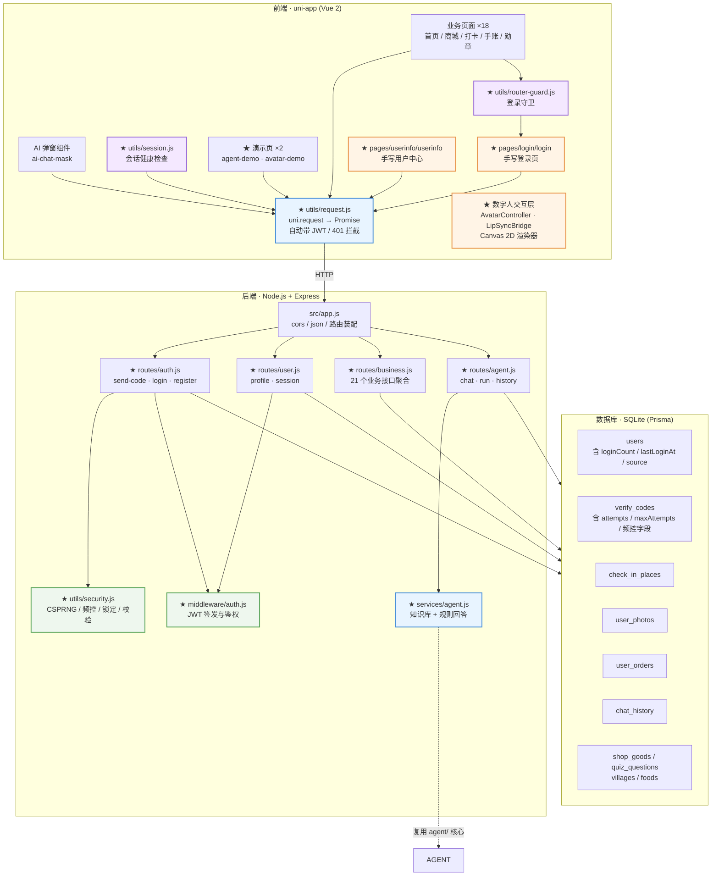

# 跨境共生小程序 · Cross-Border Symbiosis

> **乡村美食打卡小程序 + 自研 Agent 编排层 + 自研数字人交互层**
> 前后端分离架构：uni-app (Vue 2) 前端 + Node.js/Express 后端 + SQLite 数据库。
> **零付费云依赖，不需要注册任何云账号，本地即可完整跑通。**

**Author: CharLene** · **License: MIT** · **当前版本: v2.0.0 (Sprint 0–5 完成)**

> 📌 **Sprint 5 架构重构说明**
> 本项目在 Sprint 5 从 uniCloud（BaaS）重构为**标准前后端分离**架构。
> 起因是阿里云免费空间停止申请，原有后端无法继续使用。
> 重构后**彻底移除了 uniCloud 依赖**：云函数、云数据库、官方 uni-id 模块全部删除，
> 登录、Agent、业务数据全部由本地 Express 服务承载。
> 详见 [Getting Started](#getting-started) 与 [Architecture](#architecture)。

---

## Overview

### 这个项目解决什么问题

「跨境共生」是一个面向乡村文旅的美食打卡小程序：用户浏览村庄美食、拍照打卡、赚取积分、兑换特产。

项目在既有业务之上，要解决三件工程上真正困难的事：

1. **登录态不可靠** —— 原始项目直接使用 uni-id 默认配置，验证码用 `Math.random()` 生成（可预测）、错误尝试无次数限制、发送无频率限制，且没有"token 是否即将过期"的感知机制。用户会在关键操作（打卡 / 下单）时遭遇静默失败。
2. **"AI 功能"名不副实** —— 原始实现的 `ai-agent` 云函数本质是「知识库检索 + 单轮 LLM 问答」：没有工具调用、没有规划、没有降级链、没有可观测性。它拿不到用户的打卡记录、订单、签到数据，也无法执行任何动作。
3. **数字人只是两张 GIF** —— 原始实现的"数字人"是 `isSpeaking` 布尔量驱动的整图切换，口型是开/关两态而非参数化开合，没有队列、没有打断语义。

### 为什么值得做

这三件事的共性是：**表面功能可用，底层机制缺失**。本项目的价值不在于堆功能，而在于把这三处"能跑但不对"的地方，换成**可解释、可测试、可在面试中讲清楚**的自研机制。

项目采用 **Sprint 0 → 5 的敏捷迭代**，每个 Sprint 都有可运行增量，git 历史完整呈现迭代过程。

Sprint 5 增加了一层考验：**把后端从 uniCloud 整体换成自建 Express 服务**，
同时证明「换后端没有引入安全退化」。这比单纯的功能开发更能体现工程判断力 ——
架构迁移的风险不在于写不写得出来，而在于**会不会悄悄丢掉什么**。

---

## Tech Stack

### 前端

| 层次 | 技术选型 | 说明 |
|---|---|---|
| 跨端框架 | uni-app (Vue 2) | HBuilderX 工程，一套代码编译到微信小程序 / H5 / App(Android) |
| 状态与视图 | Vue 2 Options API | 与既有 18 个业务页面保持一致，不做框架迁移 |
| 网络层 | **自研 `utils/request.js`** | `uni.request` → Promise，自动携带 JWT，401 自动清凭证跳登录 |
| 路由与守卫 | `pages.json` + **自研 `utils/router-guard.js`** | `authRouter.needLogin` 声明受保护页面 |
| UI 组件 | DCloud 官方 uni_modules ×8 | `uni-forms` / `uni-easyinput` / `uni-popup` / `uni-icons` 等**纯 UI** 模块（不含云依赖） |

### 后端

| 层次 | 技术选型 | 说明 |
|---|---|---|
| 运行时 | Node.js ≥ 18 | 零外部服务依赖 |
| Web 框架 | **Express 4** | RESTful API，路由按业务域拆分 |
| 数据库 | **SQLite**（本地文件） | 零配置零成本，文件即数据库 |
| ORM | **Prisma 6** | 10 张表，schema 即代码 |
| 身份认证 | **JWT**（jsonwebtoken） | HS256 签名，7 天有效期 |
| 密码加密 | **bcryptjs** | 密码登录路径使用 |
| 验证码 | **crypto.randomInt** | CSPRNG，非 `Math.random` |
| 跨域 | **cors** 中间件 | 默认允许全部来源，本地开发友好 |
| 配置 | **dotenv** | `.env` 管理，`.env.example` 为模板 |
| 文件上传 | **multer 2** | 替代原 `uniCloud.uploadFile` |
| Agent 编排 | **自研**（复用 `agent/` 核心） | planner / executor / memory / fallback / 工具注册表 / trace |
| 数字人渲染 | **自研 Canvas 2D** | 无 Live2D、无二进制模型，形象由代码绘制 |

### 关键结论

> **整个项目不依赖任何付费云服务，也不需要注册任何云账号。**
> clone → `npm install` → `npx prisma db push` → `npm run dev`，即可在本地完整跑通。

---

## Architecture



**★ 标记为本次自研的模块**，其余为既有业务资产。

> **Sprint 5 的架构变更要点**
>
> | 变更 | 之前 | 之后 |
> |---|---|---|
> | 后端形态 | uniCloud 云函数（BaaS） | 独立 Node.js/Express 服务 |
> | 数据库 | 阿里云云数据库 | 本地 SQLite 文件 |
> | 账户体系 | 官方 uni-id-pages + uni-id-co | 自研 JWT + 自研登录页 |
> | 请求层 | `uniCloud.callFunction` | `utils/request.js` 统一封装 |
> | 路由守卫 | 官方 `uniIdRouter` | 自研 `utils/router-guard.js` |
> | Agent 编排 | 前端运行 | **服务端运行**（后端可直接 require `agent/` 核心） |
> | 文件上传 | 腾讯云 COS 直传 | 本地后端 `multer` |
>
> **Agent 编排层为什么搬到服务端？**
> Sprint 2 时编排层放在前端，原因是「HBuilderX 上传云函数只打包 `cloudfunctions/<name>/`，
> 云函数无法 require 项目根的 `agent/`」。成为独立 Node 服务后这个约束消失了：
> 后端可以直接 `require('../../agent/core/planner')` 复用同一套编排核心，
> 同时编排逻辑与知识库、用户数据同处一地，能直接查数据库，
> 且多用户场景下 trace / memory 天然按用户隔离。

---

## Getting Started

> 📌 **本项目是前后端分离架构**：前端是 uni-app（HBuilderX 工程），
> 后端是独立的 Node.js/Express 服务，数据库是本地 SQLite 文件。
>
> **不需要注册任何云账号，不需要任何付费服务，clone 下来就能在本地完整跑通。**

### 环境要求

| 组件 | 版本 | 说明 |
|---|---|---|
| Node.js | **≥ 18** | 后端运行时 |
| HBuilderX | **3.8.5+** | 前端开发（uni-app 工程，非 CLI） |
| npm | ≥ 9 | 依赖管理 |

> 无需数据库服务、无需云账号、无需 Docker。

---

### 第一步：启动后端

```bash
cd server

# 1. 安装依赖
npm install

# 2. 初始化 SQLite 数据库（生成 server/prisma/dev.db，建 10 张表）
npx prisma db push

# 3. 导入种子数据（5 村庄 / 5 美食 / 7 商品 / 20 道题）
npm run seed

# 4. 启动服务（默认 3000 端口）
npm run dev
```

启动成功后会看到：

```
  ╭─────────────────────────────────────────────╮
  │  跨境共生小程序 · 后端服务已启动              │
  ╰─────────────────────────────────────────────╯

  地址      http://localhost:3000
  健康检查  http://localhost:3000/api/health
  开发模式  开启（send-code 返回 devCode）
```

**验证后端已就绪**：

```bash
curl http://localhost:3000/api/health
# {"code":200,"message":"服务运行中","uptime":1.13,"devMode":true}
```

> **`npm run seed` 不能跳过。** Sprint 5 用 Prisma 重建数据库时，
> 原有 uniCloud 的种子数据没有一起迁移过来 ——
> 跳过这一步，商城无商品、题库无题目、美食详情无正文、探索页无村庄列表。
> 脚本是幂等的（先清空业务表再写入），可重复执行。
> 只想校验种子文件格式而不写库：`node scripts/seed.js --check`。

> **H5 端地图说明**：uni-app 的 `<map>` 在浏览器端需要**腾讯位置服务 Key**，
> 没有 Key 时组件渲染为空白。本项目零配置可跑（不依赖任何云账号），
> 所以 H5 端会**自动降级**为「村庄列表」占位视图 —— 每个村庄仍可点击进入打卡，
> 功能不缺，只是没有地图底图。
> 需要地图底图时，在 `manifest.json` → `h5` → `sdkConfigs` → `maps` 里
> 填入你的腾讯地图 Key 即可自动切换回真地图。

> `dev.db` 已被 `.gitignore` 排除，不会进入版本库。
> 想从零重建，删掉 `server/prisma/dev.db` 后重新 `npx prisma db push && npm run seed` 即可。

---

### 第二步：运行前端

1. **导入项目**
   HBuilderX → 文件 → 导入 → 从本地目录导入 → 选择本仓库根目录。

2. **配置后端地址**
   默认指向 `http://localhost:3000`（见 `utils/request.js` 的 `BASE_URL`）。

   > ⚠️ **真机调试时需改为电脑的局域网 IP**，例如 `http://192.168.1.100:3000`，
   > 否则手机的 `localhost` 指向手机自身。微信开发者工具中勾选「不校验合法域名」即可。

3. **运行**
   菜单栏 运行 → 运行到浏览器 / 微信开发者工具 / 手机模拟器。

4. **登录**
   打开任意需要登录的页面（如「打卡」），会自动跳转到自研登录页
   （`pages/login/login`）。输入任意 11 位手机号 → 获取验证码 → 登录。
   **首次登录会自动创建用户。**

---

### 开发阶段如何获取验证码

后端在**开发模式**下（`server/.env` 的 `DEV_MODE=true`）不真实发送短信，
而是把 6 位验证码直接写在响应里：

```jsonc
// POST /api/auth/send-code 的响应
{
  "code": 200,
  "message": "验证码已生成（开发模式）",
  "devCode": "964729",   // ← 填到这个位置
  "expiresIn": 240
}
```

登录页会自动显示这个 `devCode`（开发模式提示框），点「获取验证码」后直接可见。

> ⚠️ **生产环境必须把 `DEV_MODE` 设为 `false`。**
> 该模式下验证码会直接出现在接口响应里，等同于绕过短信验证。

---

### 演示账号说明

数据库由 `npx prisma db push` 初始化，**不含任何预置账号**。

用任意手机号走验证码流程即可自动注册。注册后：

- `nickname` 默认为 `用户` + 手机号后 4 位
- `loginCount` 从 1 开始，每次登录递增
- 可在「我的」页面（`pages/userinfo/userinfo`）修改昵称与头像

> 仓库中**不包含任何真实用户数据**，也不包含任何不可拨打的占位手机号 ——
> 这比 Sprint 0 的做法更彻底：连种子账号都不需要。

---

### 校验仓库完整性

```bash
# 根目录（前端 + 共享模块）
npm test                # JSON 语法校验 + 前端引用残留扫描
npm run test:agent      # Agent 编排层（53 项）
npm run test:avatar     # 数字人交互层（15 项）
npm run test:normalizer # 数据归一化层（23 项）
npm run test:all        # 以上全部

# 需要后端在运行的两组（端到端）
npm run test:contract   # 前端 → HTTP → 后端 → 归一化 全链路（16 项）
cd server && npm run test:api   # 后端接口与安全设计（39 项）
```

> 全部测试零依赖，不引入 jest / mocha，clone 完即可运行。
> `test:contract` 与 `test:api` 需要后端已启动（`cd server && npm run dev`）。

**新增的两道防线**（Sprint 5.1）：

| 检查 | 命令 | 拦截什么 |
|---|---|---|
| **前端引用残留扫描** | `node scripts/check-frontend-refs.js` | 引用了已删除模块的标识符（`store.userInfo`、`uniCloud.*`、`uni_id_token`…）。这类残留在运行时抛 `ReferenceError`，页面直接白屏 —— 且批量替换脚本无法自行发现 |
| **数据归一化层单测** | `node utils/tests/normalizer.test.js` | 前后端数据形状断层。批量脚本改了「怎么发请求」，但没改「后端返回什么」，页面就读到 `undefined` |

---

### 体验两个自研模块

| 入口 | 路径 | 能看到什么 |
|---|---|---|
| **Agent 演示** | `pages/agent-demo/agent-demo` | 输入 → 规划 → 工具执行 → trace 展开 |
| **数字人演示** | `pages/avatar-demo/avatar-demo` | Canvas 形象、口型开合、表情切换、停止打断 |

Agent 演示页的四个推荐输入：

| 输入 | 预期行为 |
|---|---|
| `我登录了几次` | 单工具执行（`user-stats`） |
| `现在几点` | 单工具执行（`server-time`） |
| `我登录了几次现在几点` | **双工具串行**，按置信度降序执行 |
| `今天天气怎么样` | **降级为能力清单**，不返回任何工具结果 |

---

## Security

### 密钥治理

本项目所有第三方服务凭据**均已从源码移除**，源码只保留 `your-*-placeholder` 占位符。
统一由 [`common/app-config`](./uniCloud-aliyun/cloudfunctions/common/app-config/) 读取，优先级：

```
uni-config-center (app-config plugin, 生产)
  → config.local.json (本地私有，已被 .gitignore 排除)
  → config.json (仓库内占位符，零配置默认值)
```

`isServiceEnabled()` 会同时校验 `_enabled === true` **且** 必填字段已从占位符替换为真实值，
任一条件不满足即判定服务未启用，调用方走本地降级路径。

### 历史密钥轮换清单

以下凭据曾存在于历史版本中，**均已在生产环境完成轮换**，且已从本仓库移除：

| # | 服务 | 历史密钥位置 | 状态 |
|---|---|---|---|
| 1 | DeepSeek LLM | `ai-agent/index.js` `DEEPSEEK_API_KEY` | ✅ 已轮换并外移 |
| 2 | 讯飞 TTS | `ai-agent/index.js` `XFYUN_APPID` | ✅ 已轮换并外移 |
| 3 | 讯飞 TTS | `ai-agent/index.js` `XFYUN_API_SECRET` | ✅ 已轮换并外移 |
| 4 | 讯飞 TTS | `ai-agent/index.js` `XFYUN_API_KEY` | ✅ 已轮换并外移 |
| 5 | 百度智能云 | `analyzeFoodPhoto/index.js` `BAIDU_API_KEY` | ✅ 已轮换并外移 |
| 6 | 百度智能云 | `analyzeFoodPhoto/index.js` `BAIDU_SECRET_KEY` | ✅ 已轮换并外移 |
| 7 | 腾讯云 COS | `getCosAuth/index.js` `SecretId` | ✅ 已轮换并外移 |
| 8 | 腾讯云 COS | `getCosAuth/index.js` `SecretKey` | ✅ 已轮换并外移 |
| 9 | 腾讯云 TTS | `getTTSSignature/index.js` `SECRET_ID` / `SECRET_KEY` | ✅ 已随死代码删除 |
| 10 | 微信小程序 | `uni-id/config.json` `mp-weixin.oauth.weixin.appsecret` | ✅ 已轮换并外移 |
| 11 | 微信开放平台 | `uni-id/config.json` `app.oauth.weixin.appsecret` 等 5 处 | ✅ 已轮换并外移 |
| 12 | 阿里云短信 | `uni-id/config.json` `service.sms.smsKey` / `smsSecret` | ✅ 已轮换并外移 |
| 13 | uni-verify 一键登录 | `uni-id/config.json` `service.univerify.apiKey` / `apiSecret` | ✅ 已轮换并外移 |
| 14 | uni-id JWT | `uni-id/config.json` `tokenSecret`（原为示例值 `tokenSecret-demo`） | ✅ 已轮换并外移 |
| 15 | uni-id 请求签名 | `uni-id/config.json` `requestAuthSecret`（原为示例值） | ✅ 已轮换并外移 |

### 第三方用户数据清理

历史版本中的 `uniCloud-aliyun/database/` 曾包含**真实用户数据**，涉及 11 名真实用户的
openid、session_key、JWT token、真实 IP、昵称与头像 URL，以及真实的聊天记录、
照片 URL、订单与打卡记录。

**这些数据已全部移除**。Sprint 5 架构重构后更进一步 ——
**整个 `uniCloud-aliyun/` 目录已删除**，改用本地 SQLite 数据库：

| 表 | 清理前 | 现在 |
|---|---|---|
| `users` | 11 条真实用户记录 | 空表，用任意手机号注册即自动创建 |
| `chat_history` | 3 条真实对话 | 空表 |
| `user_photos` | 8 条真实照片记录 | 空表 |
| `check_in_places` | 33 条真实打卡记录 | 空表 |
| `user_orders` | 5 条真实订单 | 空表 |

数据库文件 `server/prisma/dev.db` 已被 `.gitignore` 排除，**永不进入版本库**。
仓库中不含任何真实用户数据，也不含任何占位手机号。

### 迁移自 uniCloud 的架构重构（Sprint 5）

起因是阿里云免费空间停止申请，原有 BaaS 后端无法继续使用。
重构后**彻底切断 uniCloud 依赖**：

| 移除项 | 说明 |
|---|---|
| `uniCloud-aliyun/` 整个目录 | 21 个云函数 + 13 张表 + 公共模块 |
| `uni_modules/uni-id-pages` | 官方登录页与用户中心（含内嵌 uni-id-co 云函数） |
| `uni_modules/uni-id-common` | 官方 JWT/token 核心库 |
| `uni_modules/uni-config-center` | 官方配置中心 |
| `uni_modules/uni-captcha` | 官方图形验证码 |
| `uni_modules/uni-cloud-s2s` / `uni-open-bridge-common` | 云通信模块 |
| `uni_modules/uni-data-checkbox` / `uni-list` | 内部含 uniCloud 调用，前端零使用 |
| `manifest.json` 的 `_spaceID` | 阿里云空间绑定信息 |
| `.hbuilderx/launch.json` | uniCloud 调试配置 |

**保留**的 8 个 uni_modules（`uni-badge` / `uni-easyinput` / `uni-forms` /
`uni-icons` / `uni-load-more` / `uni-popup` / `uni-scss` / `uni-transition`）
经逐一核查**均为纯 UI 组件，零 uniCloud 依赖**，删除它们等于重写 UI。

自研替代方案：

| 原 uniCloud 能力 | 现在的自研实现 |
|---|---|
| `uni-id-co.loginBySms` | `server/src/routes/auth.js` + `utils/security.js` 四道安全闸 |
| `uni-id-co.checkToken` | `server/src/middleware/auth.js`（JWT） |
| `session-audit` 云函数 | `GET /api/user/session` |
| `uniCloud.callFunction` | `utils/request.js` + `utils/auth.js` |
| `uniCloud.uploadFile` | `POST /api/business/upload`（multer） |
| 官方 `uniIdRouter` 守卫 | `utils/router-guard.js` |
| 官方登录页 | `pages/login/login`（手写，视觉沿用原项目暖色系） |
| 官方用户中心 | `pages/userinfo/userinfo`（手写） |
| `ai-agent` 云函数 | `server/src/services/agent.js` + `routes/agent.js` |

> **安全设计一条没丢**：CSPRNG 验证码、60 秒 + 单日 10 次频控、
> 连错 5 次锁定、手机号严格类型校验、JWT 鉴权 —— 全部保留并有对应的单元测试。

---

## Configuration

### 零配置可跑

仓库 clone 后**不做任何额外配置**，默认路径即可完整跑通，且**不产生任何外部 API 费用**。

所有收费服务均为**可选适配器，默认关闭**。

> 配置载体是标准的 `server/.env`（由 `dotenv` 加载）。
> 模板见 [`server/.env.example`](./server/.env.example)。

### 能力开关表

| 能力 | 当前实现 | 默认策略 | 免费替代路径 | 启用方式 |
|---|---|---|---|---|
| 账号体系 | 自研 JWT（jsonwebtoken） | 🟢 **默认可用** | — | 无需配置 |
| 数据库 | 本地 SQLite + Prisma | 🟢 **默认可用** | — | `npx prisma db push` 一次即可 |
| 验证码下发 | 开发模式直接返回 `devCode` | 🟢 **默认可用** | — | `DEV_MODE=true` |
| 真实短信 | 阿里云短信（收费） | 🟡 **可选** | 开发模式 `devCode` | 接入短信服务商 SDK |
| LLM 问答 | DeepSeek API（收费） | 🔴 **默认关闭** | 本地 `knowledge.json` 检索 + 规则回答（零依赖） | `DEEPSEEK_ENABLED=true` + 填 `DEEPSEEK_API_KEY` |
| LLM 意图分类 | DeepSeek API（收费） | 🔴 **默认关闭** | `rule-adapter` 关键词加权分类 | 同上 + 显式传入 `llmAdapter` |
| TTS 语音 | 讯飞 WebSocket（收费） | 🔴 **默认关闭** | 纯口型动画 + 打字机（无音频也能演示） | `XFYUN_ENABLED=true` + 填 3 项凭据 |
| 图片识图 | 百度智能云（收费） | 🔴 **默认关闭** | 手动输入食材名，走本地规则 | `BAIDU_ENABLED=true` + 填 2 项凭据 |
| 文件存储 | 本地磁盘（multer） | 🟢 **默认可用** | — | 无需配置 |
| Agent 编排 | 规则适配器（自研） | 🟢 **默认可用** | — | 无需配置 |
| 数字人渲染 | Canvas 2D（自研） | 🟢 **默认可用** | — | 无需配置 |
| 会话健康检查 | `/api/user/session`（自研） | 🟢 **默认可用** | — | 无需配置 |

> 详细的获取方式与配置位置，见 [`server/.env.example`](./server/.env.example)。

### 开发期开关

```bash
# server/.env
DEV_MODE=true          # 🔴 生产必须 false
```

开启 `DEV_MODE` 后，`POST /api/auth/send-code` 不真实下发短信，
验证码写入后端日志并在响应的 `devCode` 字段中返回，便于无短信服务商时的本地自测。

> 🔴 **生产环境必须为 `false`**，否则验证码会直接暴露在接口响应里，
> 等同于绕过短信验证。

### 必须手动配置的一项（生产必需）

```bash
# server/.env
JWT_SECRET=<高强度随机串>   # ← 必须替换，JWT 签名密钥
```

生成方式：

```bash
node -e "console.log(require('crypto').randomBytes(32).toString('hex'))"
```

> 🔴 **不替换则任何人都能伪造登录 token。**
> `server/.env` 已被 `.gitignore` 排除，不会进入版本库。
> `server/.env.example` 中的占位符仅供说明，不可用于生产。```

这两项若不替换，示例值 `tokenSecret-demo` 会被沿用，**任何人都能伪造登录 token**。

---

## Known Issues & Limitations

如实列出当前已知的问题与限制。**不夸大、不掩饰。**

### 🔴 未实际验证的操作

| # | 项目 | 状态 | 说明 |
|---|---|---|---|
| 1 | **APK 未实际打包** | ⬜ 未执行 | 无 DCloud 账号与打包凭据，且本地无 HBuilderX CLI。`build-apk.yml` 结构正确、YAML 校验通过，但**未在真实环境跑通**，不产出 APK |
| 2 | **真机安装未验证** | ⬜ 未执行 | 无 Android 真机环境。「Android 10+ 安装不闪退」是待验证项，不是已验证结论 |
| 3 | **真实短信未发送** | ⬜ 未执行 | 短信服务商未接入。`send-code` 的完整逻辑经 39 项后端测试验证（含频控、锁定），但**真实短信链路未跑通** |
| 4 | **前端未在 HBuilderX 中实际运行** | ⬜ 未执行 | Sprint 5.1 修复 12 类运行时断裂、Sprint 5.2 修复 12 类原生能力与 UI 缺陷，累计新增 46 项前端测试 + 2 个静态扫描器兜底；但**仍未在 HBuilderX 模拟器/真机中点过一遍**。真机调试还需把 `BASE_URL` 改为局域网 IP |
| 5 | **git 未 push** | ⬜ 未执行 | 仓库无 remote，按约定不自行添加 |
| 6 | **Canvas 渲染未在真机/模拟器验证** | ⬜ 未执行 | 渲染逻辑有单元测试覆盖（参数裁剪、表情切换、无 ctx 不抛异常），但实际画面效果需在 HBuilderX 中运行确认 |

### 🟡 设计上的已知限制

| # | 项目 | 影响 | 计划 |
|---|---|---|---|
| 7 | **口型映射是近似的** | 不是音素级对齐。刻意不引入拼音库（会增数百 KB 依赖），用字符类别近似替代 | 见 Future Work |
| 8 | **`analyzeAudio` 接口未实现** | 音频驱动的口型同步不可用。需 Web Audio AnalyserNode，且 App 端与 H5 端 API 不一致 | 见 Future Work |
| 9 | **`chat_history` 是覆盖写** | 每用户只存最后一条，不是真正的历史记录 | 见 Future Work |
| 10 | **TTS 默认 noop** | 数字人默认不出声，只有口型动画。启用需配置讯飞 | 见 Future Work |
| 11 | **Agent 默认规则适配器** | 意图识别基于关键词加权，换一种问法可能识别不到 | 见 Future Work（LLM 适配器） |
| 12 | **业务数据接口按 name 聚合** | `/api/business/:name` 而非每域一个路由文件。优点是前端改动最小、协议替换纯粹；缺点是单文件较长 | 刻意选择，见 Architecture |
| 13 | **数字人形象为简笔风格** | 目标是链路自研可讲，不追求视觉精美 | — |
| 14 | **知识库同义问法用双竖线拼接** | 可维护性差 | 见 Future Work |
| 15 | **图片识别降级为本地规则** | 未接百度 AI 时只返回「未识别」与说明文字 | 见 Future Work |
| 16 | **SQLite 单机存储** | 不适合多实例部署与高并发。生产环境建议换 PostgreSQL（Prisma 改一行 datasource 即可迁移） | 见 Future Work |
| 17 | **文件上传存本地磁盘** | 多实例部署时图片不共享。生产建议换对象存储 | 见 Future Work |
| 18 | **Android 存储权限用 READ/WRITE_EXTERNAL_STORAGE** | Android 13+ 已废弃该模式，需迁移到 `READ_MEDIA_IMAGES` | 打包上架前处理 |
| 19 | **题目 slug 映射维护在前端** | `QUIZ_SLUG_MAP` 靠题目文本反查所属村庄。Prisma 的 `QuizQuestion` 没有 slug 字段（本轮约定不改后端）。新增题目时需同步维护这张表，否则新题会被归到 default 组 | 见 Future Work（给 schema 加 slug 字段） |
| 20 | **答题进度不含 quiz 维度** | 原云函数查 `userQuizLogs` 表算答题进度，新后端没有这张表。进度分母仍按 4 计算，因此实际进度会偏低 0/25/50/75 | 见 Future Work（新增 quiz_logs 表） |
| 21 | **H5 端无地图底图** | `<map>` 在浏览器端需要腾讯位置服务 Key，零配置下自动降级为村庄列表占位视图。功能不缺，只是没有地图 | 在 `manifest.json` 填入腾讯地图 Key 即可恢复 |
| 22 | **品鉴评分是本地模拟** | `analyzeFoodPhoto` 返回确定性哈希生成的 80-95 分与随机点评，不是真实图像识别 | 见 Future Work（接入百度 AI 凭据） |
| 23 | **H5 端定位不可用** | 浏览器定位要求 HTTPS + 用户授权，非 HTTPS 的本地调试无法定位。页面提供「模拟打卡」按钮跳过定位（走相同后端接口） | 真机调试或部署 HTTPS |
| 24 | **打卡景点名存在 address 字段** | 后端 `CheckInPlace` 模型没有 `checkType` 字段，景点名借 `address` 承载以支持状态回显 | 见 Future Work（给 schema 加 checkType 字段） |

### 🟢 环境相关的注意事项

| # | 项目 | 说明 |
|---|---|---|
| 25 | `server/.env` 的 `JWT_SECRET` 现为占位符 | **部署前必须替换**，否则 JWT 可被伪造。生成方法见 Production Deployment |
| 26 | `server/.env` 的 `DEV_MODE` 现为 true | **生产必须改为 false**，否则验证码直接出现在接口响应里 |
| 27 | 真机调试需改 `BASE_URL` | `http://localhost:3000` 在手机上指向手机自身，需改为电脑局域网 IP |
| 28 | 旧 uniCloud 资源仍在云端 | 若之前关联过阿里云空间，那些云函数仍存在，但**本项目已不再使用**，可自行在控制台清理 |
| 29 | **必须执行 `npm run seed`** | Sprint 5 用 Prisma 重建数据库时未迁移原 uniCloud 的种子数据。跳过这一步，商城/题库/美食/村庄列表全为空 | Getting Started 第二步已补上该命令 |

---
## Features

按模块列出，标注完成状态。

### 🔧 Sprint 5.1 修复补丁（重构车祸的 12 类断裂）

| 断裂 | 症状 | 修复 |
|---|---|---|
| Agent 传参用错字段 | `POST /api/agent/chat 400 缺少提问内容` | `agentApi.chat` 显式支持 `{message}` / `{messages}`，不再把整个对象当 message |
| `checkStatus`/`tts` action 不存在 | AI 弹窗整体禁用、打卡页拍照入口禁用 | 本地恒定启用 + 探活日志；TTS 降级为不出声 |
| 响应路径错误 | 拿到答案但页面不显示 | 兼容 `res.answer` 与 `res.result.choices[0]` |
| `addCongmeiOverlay` 从未定义 | 首页 `TypeError`，地图与弹窗全挂 | 补齐实现 + `safeAddOverlay` 防御，单个图层失败不拖垮首页 |
| `store.userInfo` 残留 | 勋章页/手账页 `ReferenceError` 白屏 | 改为读本地缓存 |
| `userInfo._id` 不存在 | 已登录但用户数据不显示 | `withLegacyId` 补 `_id` 别名 |
| 业务 ID 与主键混淆 | 打卡进度永远 0 | 村庄 `_id` 映射回 `'101'`–`'105'` |
| 题库字段名不同 | 答题页空白 | 归一化补 `title`/`options`/`answerIndex` + 按 slug 过滤 |
| 商品字段名不同 | 商城图片/描述空白 | 归一化补 `_id`/`img_url`/`description` |
| `code === 0` 判定 | 美食详情永远「未找到」 | 兼容 200 与 0 |
| `res.data.newPoints` 不存在 | 兑换后积分变 undefined | 优先服务端余额，否则本地扣减 |
| 守卫在 `onLoad` 判断路由 | 未登录可绕过守卫 | 显式传路由，消除页面栈时序依赖 |
| 种子数据未迁移 | 全新 clone 后所有列表为空 | `server/scripts/seed.js` + `server/data/seed.json` |


### 🔧 Sprint 5.2 修复补丁（原生能力降级 + UI 细节还原）

| 断裂 | 症状 | 修复 |
|---|---|---|
| 首页地图空白 | H5 端 `<map>` 无腾讯地图 Key → 渲染为空白 | `utils/map-capability.js` 检测平台与 Key，不可用时降级为「村庄列表」占位视图，每个村庄仍可点击进入打卡 |
| 定位打卡没反应 | `uni.getLocation` 失败只 `console.error`，界面无任何反馈 | 捕获错误 → 状态卡片显示针对性提示（权限/HTTPS/超时/不支持）+ toast 提示 + 「重试」按钮 |
| 无法在 Web 端联调打卡 | H5 端定位受限，无法完成打卡链路 | 新增「模拟打卡」按钮：跳过定位，走**完全相同**的后端接口与参数 |
| 打卡参数错位 | 前端不传 `type`，后端默认 `photo` → 定位打卡被误判为拍照打卡，进度统计错 | 补齐后端真正读取的 `type` 与 `address` 字段 |
| Agent 只回兜底话术 | `/api/agent/chat` 只做知识库检索，「我是谁」「几点了」全走降级 | 知识库未命中时**接入 Agent 编排层**（planner + executor），可查用户信息与服务器时间 |
| `user-stats` 工具读到 undefined | 工具读 uniCloud 字段名 `login_count`，而 Prisma 是 `loginCount` | 工具兼容两套字段名 |
| 规则引擎识别不了「我是谁」 | 关键词全是「登录/几次/注册」 | 补身份类与口语化时间关键词；权重 0 的提示词不计入匹配 |
| 拍照后无评分与点评 | `analyzeFoodPhoto` 返回的字段与前端期望（`isFood`/`score`/`comment`/`tags`）完全对不上 | 新增 `server/src/services/food-review.js` 本地品鉴引擎：确定性哈希 → 80-95 分 + 美食点评 + 标签，零外部依赖 |
| **上传接口 404** | `router.post('/:name')` 注册在 `/upload` 之前 → `/upload` 被 `:name` 抢先匹配 | 上传路由前移（Express 按注册顺序匹配），并加回归测试 |
| 相册图片裂图 | 后端返回相对路径 `/uploads/x.png`，H5 端当站点根路径请求 → 404 | 新增 `utils/url.js`，归一化层统一拼成绝对 URL |
| 相册空白无提示 | 未登录/加载失败都显示「相册还是空的」 | 区分「加载中 / 未登录 / 加载失败 / 空相册」四种状态 |
| 页面成死胡同 | 删 uni-id-pages 后原生导航栏在 Web 端不渲染返回键 | 新增自研 `components/nav-bar`，覆盖 4 个手写页面 |

### 📱 业务功能（既有资产，已增强）

| 模块 | 功能 | 状态 |
|---|---|---|
| 首页 | 村庄介绍、美食推荐、打卡入口 | ✅ |
| 商城 | 特产商品浏览、下单购买、积分抵扣 | ✅ |
| 美食详情 | 菜品详情、图片墙、制作步骤 | ✅ |
| 探索 | 地图选点、村落信息展示 | ✅ |
| 万物长廊 | 村庄风物展示 | ✅ |
| 旅途手账 | 打卡记录时间轴 | ✅ |
| 共生勋章 | 积分与成就体系 | ✅ |
| 打卡 | 定位打卡、拍照上传、做菜打卡、答题打卡 | ✅ |
| 我的 | 点赞、相册、打卡记录、账户资料、关于 | ✅ |
| 每日签到 | 签到积分、连续签到统计 | ✅ |

### 🔐 账户与安全（Sprint 1 设计 + Sprint 5 重建）

| 功能 | 说明 | 状态 |
|---|---|---|
| 手机号验证码登录 | `POST /api/auth/send-code` + `/api/auth/login`，用户不存在自动注册 | ✅ |
| 手写登录页 | `pages/login/login`，视觉沿用原项目暖色系 | ✅ Sprint 5 |
| 手写用户中心 | `pages/userinfo/userinfo`，含昵称/头像编辑与登录统计 | ✅ Sprint 5 |
| JWT 鉴权 | `jsonwebtoken` HS256，7 天有效期，中间件统一拦截 | ✅ Sprint 5 |
| CSPRNG 验证码 | `crypto.randomInt`，替代 `Math.random` | ✅ |
| 发送频率限制 | 同号 60 秒一次 + 单日 10 次上限 | ✅ |
| 错误次数锁定 | 连错 5 次验证码作废，需重新获取 | ✅ |
| 手机号严格类型校验 | 拒绝数组/数字/null 等异常入参 | ✅ |
| bcrypt 密码哈希 | 密码登录路径 | ✅ Sprint 5 |
| 会话健康检查 | `GET /api/user/session`，返回有效期/即将过期/设备数/登录地 | ✅ |
| 静默续期 | 剩余 < 600s 自动刷新，用户无感知 | ✅ |
| 路由守卫 | 自研 `utils/router-guard.js`，9 个受保护页面（打卡 5 + 我的 4），公开页面不受影响 | ✅ Sprint 5.1 |
| 登录统计字段 | `loginCount` / `lastLoginAt` / `source` | ✅ |

### 🤖 Agent 编排层（Sprint 2 设计 + Sprint 5 迁至服务端）

| 功能 | 说明 | 状态 |
|---|---|---|
| 两阶段规划 | 意图分类 → 工具序列规划 | ✅ |
| 多工具串行 | 复合提问自动拆解为多个工具调用 | ✅ |
| 工具注册表 | 四要素声明 + JSON Schema 校验 | ✅ |
| 降级链 | 低置信度返回能力清单，不猜测工具 | ✅ |
| 可观测 | 每次调用生成 trace，环形缓冲保留 20 条 | ✅ |
| 短期记忆 | 滑动窗口，可选持久化 | ✅ |
| 规则适配器 | 默认路径，零外部依赖 | ✅ |
| LLM 适配器 | 可选启用，需配置 Key | ✅（可选） |
| Agent 演示页 | 输入 → 规划 → 执行 → trace 查看 | ✅ |
| **服务端编排** | Sprint 5：后端可直接 require `agent/` 核心，编排与数据同处一地 | ✅ Sprint 5 |

### 🎭 数字人交互层（Sprint 3 新增）

| 功能 | 说明 | 状态 |
|---|---|---|
| Canvas 2D 形象 | 纯代码绘制，无 Live2D、无模型文件 | ✅ |
| 口型同步 | 文本 → 口型参数序列，实时驱动 | ✅ |
| 4 种表情 | 中性/开心/思考/惊讶 | ✅ |
| 打断语义 | `stop()` 立即复位，覆盖式不排队 | ✅ |
| TTS 适配器 | 默认 noop（只做口型），可选真实语音 | ✅（可选） |
| Agent 联动 | `avatar-speak` 工具，Agent 可触发口播 | ✅ |
| 数字人演示页 | Canvas + 输入 + 说话/停止/表情切换 | ✅ |

### 🔧 工程化

| 功能 | 说明 | 状态 |
|---|---|---|
| **零付费云依赖** | 不需要注册任何云账号，本地完整跑通 | ✅ Sprint 5 |
| **零配置可运行** | clone → npm install → prisma db push → npm run dev | ✅ Sprint 5 |
| 密钥治理 | 全部经 `server/.env`，源码零凭据 | ✅ |
| 自动化测试 | 前后端共 107 项（JSON + 53 Agent + 15 数字人 + 39 后端） | ✅ |
| CI 工作流 | push tag 自动构建，产出 artifact | ✅（需配置 secrets） |
| 上线文档 | 五阶段流程 + 检查清单 | ✅ |

---
## Technical Highlights

> 每个亮点用「问题 — 机制 — 结果」三段式写。

### 亮点 1 · Agent 两阶段规划与降级链

**问题**
规则驱动的 Agent 在未知输入下最容易犯的错，是**硬猜一个工具并返回看似合理的结果**。
用户问「今天天气怎么样」，Agent 却不动声色地返回了服务器时间 —— 答非所问，却没有任何错误提示。
这类"沉默的错误"比直接报错更难排查：用户困惑，开发者也无从下手。

**机制**
在 `agent/core/planner.js` 实现两阶段规划：

1. **阶段一 · 意图分类** —— 关键词加权打分，每个意图声明关键词与权重，
   命中即累加，再按覆盖率加成，归一化得到置信度 ∈ [0,1]
2. **阶段二 · 工具序列规划** —— 把意图映射为工具调用序列，
   复合提问自动拆解为多工具并按置信度降序**串行**执行

关键在阈值机制（`agent/core/fallback.js`）：
**置信度低于 0.3 时，planner 不产出任何工具序列**，
转而返回一份从工具注册表实时读取的**能力清单** ——
把「我不知道」变成「你可以这样问我」。

配套的两条硬约束：
- 工具参数校验失败**返回结构化错误而非抛异常**（`agent/tools/index.js`）
- LLM 只用于意图分类，最终答案**永远由工具的真实返回值聚合** ——
  即使模型判断错了意图，也不会凭空编造事实，trace 会如实记录这个错误

**结果**
- 单元测试 **53 项全绿**，覆盖 4 类规定场景：正常意图、多工具串行、未知意图降级、参数校验失败
- 未知意图 **100% 走降级路径**，不返回任何工具执行结果
  （断言：`type === 'fallback'` 且 `results.length === 0`）
- 每次调用产出 trace（输入 / 规划 / 每步耗时 / 输出），
  环形缓冲保留最近 20 条，可在演示页展开查看
- 排查「回答得不对」时，可直接定位是**意图识别错**、**参数错**、还是**工具抛异常**

---

### 亮点 2 · 换后端不丢一项安全设计

**问题**
Sprint 5 要把后端从 uniCloud 换成自建 Express 服务。
这类「换后端」的重构最容易出的事故，是**顺手把安全机制一起丢掉**：
验证码能无限试、频控没了、token 不校验了 —— 功能都跑得通，但安全性悄悄退化了。
更隐蔽的是：官方 `uni-id` 的那些防护是**隐式**的，
开发者以为「用了 uni-id 就等于有防护」，实际上一旦自研登录，这些防护全部消失。

**机制**
把 Sprint 1 设计的四道安全闸**逐条翻译**到新后端，并写进契约测试：

| 安全设计 | uniCloud 时代 | Express 时代 | 落地位置 |
|---|---|---|---|
| ① 手机号严格校验 | uni-id 的 `mobile` schema（隐式） | **显式** `typeof === 'string'` + 正则 | `server/src/utils/security.js` |
| ② CSPRNG 验证码 | ❌ 用的是 `Math.random()`（不安全） | ✅ `crypto.randomInt` | 同上 |
| ③ 发送频控 | ❌ 无 | ✅ 60 秒 + 单日 10 次 | 同上（`verify_codes` 表字段） |
| ④ 错误次数锁定 | ❌ 无 | ✅ 5 次作废 | 同上（`attempts` 字段） |
| ⑤ Token 鉴权 | uni-id-co 的 `checkToken`（隐式） | **显式** JWT 中间件 | `server/src/middleware/auth.js` |
| ⑥ 会话健康检查 | 自研 `session-audit` 云函数 | 改为 `GET /api/user/session` | `server/src/routes/user.js` |

关键决策是**把隐式防护变成显式契约**：
每一项都有对应的断言与测试用例，而不是"框架应该会处理"。

**结果**
- 后端 **39 项契约测试全绿**，逐条断言上述 6 项安全设计
- 7 种异常手机号入参（数组/数字/null/undefined/对象/布尔/格式错）
  全部返回结构化错误，**零未捕获异常**
- 60 秒内二次发送返回 **429 + `auth-sms-too-frequent` + `retryAfter`**
- 连错 5 次后**即使提交正确验证码也无法登录**（已实测）
- 不带 token / 伪造 token 一律 **401**，带 token 正常返回
- 用户资料接口**无法篡改 `loginCount`** 等服务端维护的字段
  （传了返回 `user-nothing-to-update`）
- 前端请求层同步提供**兜底**：`utils/request.js` 拦截 401 后
  自动清除本地凭证并跳转登录页，替代了原来的 session-audit 职责

> 这条亮点的价值不在于"做了安全功能"，而在于**证明重构没有引入安全退化** ——
> 而这正是架构迁移类工作中最容易被忽略、也最容易被面试官追问的部分。

---

### 亮点 3 · 数字人音频—口型桥接与 Agent 联动

**问题**
现成的数字人方案只负责**渲染**，不负责**调度**。
即便接入了 Live2D，也仍需回答三个问题：
口型怎么算？播报怎么排队？用户打断怎么办？
这三件事没有现成答案，只能自己写 —— 而它们恰恰是数字人体验好坏的关键。

**机制**
自研 `digital-avatar/` 交互层，核心是三个可独立测试的部件：

**① LipSyncBridge**（`bridge/lipsync.js`）—— 纯函数，不依赖音频
按 Unicode 码点切分文本，逐字符估算发音时长（汉字 200ms / 字母 120ms / 标点停顿），
映射为口型开合值 ∈ [0,1]，输出 `[{t, value}]` 序列。
播放时按时间轴**线性插值采样**，让口型过渡平滑而非阶跃跳动。

**② AvatarController**（`controller/avatar-controller.js`）—— 打断语义
`speak` / `stop` / `setExpression` 三方法，`requestAnimationFrame` 驱动播放循环。
覆盖式打断（新的 `speak` 打断旧的），`stop()` 立即取消 rAF 并复位口型。

**③ Agent 联动**（`agent/tools/avatar-speak.js`）
把数字人封装成 Agent 工具，executor 调用即触发口播。

**结果**
- 口型序列单元测试 **15 项全绿**：序列长度匹配、value 值域 [0,1]、t 单调递增、标点闭合、插值边界
- `stop()` 立即复位口型为 0 并取消 rAF（已断言）
- 连续 `speak()` 三次，**仅保留一条 rAF 链**，无双动画（已断言）
- Agent 执行 `avatar-speak` 工具后，数字人随即开口（已断言）
- **精度边界如实声明**：口型映射是近似的，不是音素级对齐。
  不做真实拼音转换是刻意的取舍 —— 完整拼音库会增加数百 KB 依赖，
  与「clone 即可运行、零外部依赖」的约束冲突

---

### 亮点 4 · 外层包装而非侵入式改写

**问题**
原始项目的登录基于 DCloud 官方 `uni-id-co`。
要补验证码安全、频控、错误锁定，最直接的做法是改它的源码 —— 但那是**第三方依赖**：
改了就无法跟随官方升级，官方修 bug 时会产生冲突，审计时也说不清"哪些是自研"。

**机制**
Sprint 1 用 `auth-gateway` 做**外层薄包装**：

```
客户端 → auth-gateway → 四道安全闸 → uni-id-co → 云数据库
```

- `auth-gateway/index.js` 仅 42 行，只做编排与转发
- 四道闸的实现下沉到 `lib/guards.js`，与业务处理 `lib/handlers.js` 分离
- 转发用 `uniCloud.importObject('uni-id-co')`，并透传 `clientInfo`
  以通过 uni-id-co 内部的 `checkClientInfo` 校验

**结果**
- `uni-id-co` 源码 **sha256 基线比对零改动**（每个 Sprint 结束时验证）
- `uni_modules/` 官方模块整体零改动，唯一的例外是 `uni-id/config.json`
  ——那是**配置层**（密钥占位符化），非源码
- 官方升级时只需重新比对基线，不存在合并冲突
- Sprint 1 结束时 `auth-gateway` 主文件 42 行，远低于 150 行的设计上限

> Sprint 5 彻底移除 uniCloud 后，这套「不改第三方源码」的原则延续到了新后端：
> Express、Prisma、jsonwebtoken 全部以标准方式使用，不 fork、不魔改。

---

### 亮点 5 · 协议适配层：把「换了后端」变成可验证的工程

**问题**

Sprint 5 把后端从 uniCloud 云函数换成 Express + Prisma 时，
我用了脚本批量替换 44 处 `uniCloud.callFunction`。脚本改得了「怎么发请求」，
却改不了「后端返回什么」——

| 原云函数返回 | 新后端返回（Prisma 原始行） | 页面读什么 | 结果 |
|---|---|---|---|
| `getCheckInRecords` → 带 `name`/`progress` 的聚合数组 | `check_in_places` 表的行，只有 `locationId`/`type` | `item.name`、`item.progress` | 勋章页/手账页全是 `undefined` |
| `get_quiz_questions` → 按 slug 过滤 + `title`/`options` 数组 | 全量行，`options` 是 JSON **字符串** | `q.title`、`q.options` | 答题页空白 |
| `get_village_info` → `_id` 是业务 ID `'101'` | `villages.id` 是自增整数 `1` | `village._id` 当作 locationId | 打卡记录与进度**全部错位** |
| `userInit` → `{ points }` | 同 | `res.data.points` | 积分不显示 |

更隐蔽的是 `userInfo._id`：Prisma 主键叫 `id`，
而前端有 10+ 处读 `_id`（uniCloud 时代的字段名）——
于是「已登录但用户数据不显示」。

**机制**

不逐页改页面代码（风险高、易漏），而是在 `utils/auth.js` 与新文件
`utils/normalizer.js` 之间建一层**协议适配**：

```
页面  ──►  businessApi.getCheckInRecords()
              │
              ├─ withData(promise, normalizer, params)   统一取 data、套归一化器
              ├─ withUserParam(params)                   openid → userId 映射
              └─ normalizeCheckInRecords(rows)           Prisma 行 → 原云函数形状
                        │
                        └─ VILLAGE_CONFIG（前端配置）    业务 ID ↔ slug ↔ 名称
```

四个关键设计：

1. **业务 ID 与数据库主键分离**。村庄的 `_id` 映射回 `'101'`–`'105'`
   （原云函数的业务 ID），数据库主键保留在 `dbId`。
   打卡记录按 `locationId` 关联，两者必须用同一套 ID —— 否则进度永远是 0。
2. **`_id` 别名**。`withLegacyId(user)` 给用户对象补 `_id = id`，
   10+ 处页面代码一行不用改。
3. **前端持有静态配置**。`VILLAGE_CONFIG` 与 `QUIZ_SLUG_MAP` 放在前端，
   因为后端 schema 没有 slug 字段且本轮约定不改后端。
4. **契约不匹配处做适配而非绕过**。`quizCheckIn` 的前后端契约完全不同
   （前端交整卷 `answers[]`，后端收单题 `questionId`+`answer`），
   适配层用前端本地题库判分，再把 `doneForLocation`/`score` 补回响应。

**结果**

- **39 项前端单测**（归一化层 23 + 端到端契约 16）全绿
- 端到端验证：登录 → 打卡 → 落库 → **进度从 0 变成 25**（业务 ID 对齐的直接证据）
- 页面代码改动量趋近于零 —— 修复集中在 1 个新文件 + 1 个 API 层
- 后端 `src/` **零改动**（`git status server/src/` 为空）

---

### 亮点 6 · 用静态扫描器给批量替换装上「安全网」

**问题**

批量脚本能改「调用点」，改不了「引用点」。
Sprint 5 删除 `uni-id-pages` 模块时清掉了它的 `import`，
却留下了两处 `store.userInfo` 的**使用点**：

```js
computed: {
  userInfo() {
    return store.userInfo   // ← store 未定义
  }
}
```

运行时抛 `ReferenceError: store is not defined`，
computed 求值失败 → **勋章页与手账页直接白屏**。
这类问题编译器不报、静态检查不查，只有真机点一遍才会暴露。

**机制**

写 `scripts/check-frontend-refs.js`（零依赖），做两层检查：

| 层 | 规则 | 误报率 |
|---|---|---|
| **精确层** | 已删除模块的残留：`store.userInfo` / `uniIdPageInit` / `uniCloud.*` / `uni_id_token` / `uni-id-pages` … | **零误报** —— 这些名字在当前架构下根本不该出现 |
| **启发式层** | 裸标识符未被定义/导入 | 有误报（模板作用域变量），仅作提示 |

精确层直接决定退出码，**已删除模块残留引用为零**即通过。

**结果**

- 扫出并修复 2 处 `store.userInfo` 残留（勋章页 + 手账页白屏的元凶）
- 接入 `npm test`，此后每次重构都有这道防线
- 顺带修掉 `request.js` 里 `getCurrentPages()` 未定义会抛 `ReferenceError`
  的隐患 —— 401 处理链原本会因此整体崩溃

---
## Database Schema

> 数据库：**SQLite**（本地文件 `server/prisma/dev.db`），ORM：**Prisma**。
> Schema 定义见 [`server/prisma/schema.prisma`](./server/prisma/schema.prisma)。
> 数据库文件已被 `.gitignore` 排除，永不进入版本库。

### `users`（用户表）

| 字段 | 类型 | 说明 |
|---|---|---|
| `id` | Int | 主键，自增 |
| `mobile` | String (unique) | 手机号，登录主键 |
| `nickname` | String? | 昵称 |
| `avatar` | String? | 头像 URL |
| `password` | String? | bcrypt 哈希；验证码登录的账号为 null |
| `email` | String? | 邮箱 |
| `loginCount` | Int | **累计登录次数**，每次登录 +1 |
| `lastLoginAt` | DateTime? | **最近登录时间** |
| `lastLoginIp` | String? | 最近登录 IP（输出时掩码） |
| `registerDate` | DateTime | 注册时间 |
| `source` | String | **注册来源**（sms / register） |
| `points` / `score` | Int | 积分 / 评分 |
| `signinDate` / `signinDays` | String / Int | 签到状态 |

> `loginCount` / `lastLoginAt` / `source` 是 Sprint 1 设计的扩展字段，
> 在 SQLite 时代原样保留，并已通过实测验证落库。

### `verify_codes`（验证码表）

| 字段 | 类型 | 说明 |
|---|---|---|
| `id` | Int | 主键 |
| `mobile` | String | 手机号 |
| `scene` | String | 场景（login / register / bind） |
| `code` | String | 6 位验证码（**crypto.randomInt 生成**） |
| `attempts` | Int | **已错误次数**，达到上限即作废 |
| `maxAttempts` | Int | 最大允许错误次数（默认 5） |
| `expireAt` | DateTime | 过期时间（240 秒） |
| `used` | Boolean | 是否已使用（作废时置 true） |
| `lastSendAt` | DateTime? | **上次发送时间**（60 秒频控判定） |
| `dayCount` | Int | **当日已发送次数**（单日上限 10） |
| `day` | String? | 日期分桶键（YYYY-MM-DD），跨日自动重置 |
| `ip` | String? | 请求 IP |

> 设计说明：验证码与频控计数**放在同一条记录上**。
> 每次发送创建新记录（旧记录自然过期），
> 频控字段只记录在最新一条上 —— 避免了「频控表」与「验证码表」两张表的关联与同步问题。

### 业务表

| 表 | 用途 |
|---|---|
| `check_in_places` | 打卡地点记录 |
| `user_photos` | 用户打卡照片 |
| `user_orders` | 商城订单 |
| `chat_history` | 聊天记录（每用户一条，与原实现一致） |
| `shop_goods` | 商城商品 |
| `quiz_questions` | 答题题库 |
| `villages` | 村庄信息 |
| `foods` | 美食信息 |

共 10 张表。Agent 的 trace **仅存于内存环形缓冲区**，不落库 ——
trace 是调试用的短期数据，落库会带来额外的隐私与清理成本。

---

## Development Process

完整过程见 [`docs/敏捷开发过程.md`](./docs/敏捷开发过程.md)。以下为核心摘要。

### Product Backlog（节选）

| ID | 用户故事 | 优先级 | Sprint | 状态 |
|---|---|---|---|---|
| PB-01 | clone 仓库后无需任何配置即可运行 | P0 | S0 | ✅ |
| PB-02 | 源码中不出现任何真实密钥 | P0 | S0 | ✅ |
| PB-03 | 仓库不含真实用户数据 | P0 | S0 | ✅ |
| PB-05 | 用手机号验证码登录 | P0 | S1 | ✅ |
| PB-06 | 验证码 60 秒内不能重复发送 | P0 | S1 | ✅ |
| PB-07 | 验证码连错 5 次后作废 | P0 | S1 | ✅ |
| PB-08 | 登录态快过期时自动续期而非突然失败 | P1 | S1 | ✅ |
| PB-10 | 一次提问能同时得到多个信息 | P0 | S2 | ✅ |
| PB-11 | AI 听不懂时明确告知能力而非胡编 | P0 | S2 | ✅ |
| PB-12 | 能看到每次 Agent 调用的执行轨迹 | P1 | S2 | ✅ |
| PB-13 | 数字人说话时口型连续变化 | P0 | S3 | ✅ |
| PB-14 | 数字人能被随时打断 | P1 | S3 | ✅ |
| PB-15 | AI 回答时数字人自动播报 | P1 | S3 | ✅ |
| PB-16 | 能在 CI 中自动产出 APK | P1 | S4 | ✅ |
| PB-17 | 有一份可执行的上线流程 | P0 | S4 | ✅ |
| PB-18 | **不依赖任何付费云服务，本地可完整跑通** | P0 | S5 | ✅ |
| PB-19 | **后端是标准的 HTTP 服务，前后端彻底分离** | P0 | S5 | ✅ |
| PB-20 | **换后端不丢任何一项安全设计** | P0 | S5 | ✅ |

### Sprint 划分与增量

| Sprint | 主题 | 交付的增量 | 提交 |
|---|---|---|---|
| **Sprint 0** | 技术债清理与仓库工程化 | 30 项技术债盘点，P0 全 12 项关闭；6 个死代码云函数删除；真实用户数据脱敏；7 组密钥外移；`.gitignore`/`LICENSE`/`README`/`docs/` 落地 | `13703d6` |
| **Sprint 1** | 登录与账户持久化 | `auth-gateway` 四道安全闸；`session-audit` 会话体检；`utils/session.js` 静默续期 | `bbe4d01` |
| **Sprint 2** | Agent 编排层 | `agent/` 完整目录（planner/executor/memory/fallback/trace/工具注册表/双适配器）；53 项单测；Agent 演示页 | `989d89d` |
| **Sprint 3** | 数字人交互层 | `digital-avatar/` 完整目录（Canvas 2D 渲染器/口型桥接/控制器/TTS 适配器）；15 项单测；`avatar-speak` 工具打通 Agent 联动 | `08e2ed1` |
| **Sprint 4** | 打包配置与上线文档 | Android 权限收敛；`build-apk.yml` CI；README 补全；五阶段上线手册 | `256aa09` |
| **Sprint 5** | **脱离 uniCloud + 搭建真实 HTTP 后端** | **`server/` 独立后端工程（Express + Prisma + SQLite）；44 处 uniCloud 调用全部替换；手写登录页与用户中心；自研路由守卫；Agent 编排迁至服务端** | `256aa09` → 本次提交 |
| **Sprint 5.1** | **重构车祸修复补丁** | **12 类运行时断裂修复；`utils/normalizer.js` 协议适配层；39 项前端测试；`scripts/check-frontend-refs.js` 静态扫描器；种子数据迁移** | 本次提交 |
| **Sprint 5.2** | **原生能力降级 + UI 细节还原** | **地图占位视图；定位失败兜底 + 模拟打卡；Agent 接入编排层；本地品鉴引擎；上传路由顺序修复；URL 绝对化；自研 nav-bar** | 本次提交 |

### Sprint 5 的架构重构决策

起因是**阿里云免费空间停止申请**，原有 BaaS 后端无法继续使用。
这次重构不是「换个技术栈」，而是**一次彻底的后端重写**，但刻意控制了风险：

| 决策 | 选择 | 理由 |
|---|---|---|
| 后端形态 | 独立 Node.js/Express 服务 | 前后端分离是当前主流，也让后端可被任何 Node 环境托管 |
| 数据库 | SQLite + Prisma | 零配置零成本，「文件即数据库」；Prisma 换 PostgreSQL 只改一行 |
| 业务接口形态 | `/api/business/:name` 聚合路由 | **name 与原云函数同名** → 前端只需改调用方式，数据结构与 UI 完全不动 |
| 登录体系 | 自研 JWT + 手写登录页 | 官方 uni-id-pages 依赖 uniCloud，无法保留 |
| Agent 编排位置 | **从前端搬到服务端** | 后端可直接 require `agent/` 核心（Sprint 2 的约束消失了），且能直接查库 |
| 前端 UI | **完全不改结构** | 只替换 API 调用层，18 个业务页面的 UI 一行未动 |

### 每个 Sprint 的完成标准

不是"代码写完了"，而是**可验证的增量**：

| Sprint | 验证方式 | 结果 |
|---|---|---|
| S0 | 密钥扫描 13 项零命中 · PII 扫描 5 项零命中 · JSON 91 个全绿 | ✅ |
| S1 | auth-gateway 26/26 · session-audit 18/18 · 7 种异常手机号入参全部优雅拒绝 | ✅ |
| S2 | 53/53 · 四个指定输入分别产出单工具/单工具/双工具/降级 | ✅ |
| S3 | 15/15 · 口型长度/值域/单调三项性质 · stop 复位 · 覆盖无双动画 | ✅ |
| S4 | JSON 91 个全绿 · workflow YAML 校验通过 · README 全部章节有实质内容 | ✅ |
| S5 | 后端 39/39 · 全仓库 uniCloud 零残留 · 44 处调用替换 · 数据实测落库 · Agent 四场景实测 | ✅ |
| S5.1 | 前端归一化 23/23 · 端到端契约 16/16 · 残留引用扫描零命中 · 26 个 .vue 语法全绿 · 打卡进度 0→25 实测 | ✅ |
| S5.2 | 后端 50/50 · 前端 107/107 · 27 个 .vue 语法全绿 · 上传 404→200 实测 · 品鉴评分区间 80-95 实测 · Agent 编排接入实测 | ✅ |

### 全程守住的边界

| 边界 | 验证方式 | 结果 |
|---|---|---|
| 不修改 `uni-id-co` 源码 | 每个 Sprint 结束时 sha256 基线比对 | ✅ S0–S4 零改动，S5 整体删除 |
| 不修改 `uni_modules/` 官方模块 | 全量哈希比对 | ✅ S0–S4 仅配置层变更，S5 只删云依赖模块 |
| 不引入付费依赖作为默认路径 | `isServiceEnabled()` 判定 | ✅ 全部默认关闭 |
| **不声称未执行的操作** | README / 提交信息逐项核对 | ✅ 见 Known Issues |
| **Sprint 5 不改前端 UI 结构** | 只替换 API 调用层 | ✅ 18 个业务页面 UI 未动 |
| **Sprint 5 不删非计划内文件** | 每次删除前做备份目录 diff | ✅ 精确核对 |

---
## API Documentation

后端基址：`http://localhost:3000`
所有接口返回 JSON，统一结构：`{ code, errCode?, errMsg?, ... }`
认证方式：`Authorization: Bearer <token>`（`/api/auth/*` 除外）

### 1 · `POST /api/auth/send-code` —— 发送验证码

```jsonc
// 请求
{ "mobile": "13800138000", "scene": "login" }

// 响应（开发模式）
{
  "code": 200,
  "message": "验证码已生成（开发模式）",
  "devCode": "964729",     // 仅 DEV_MODE=true 时返回
  "expiresIn": 240
}
```

**错误码**：

| HTTP | errCode | 含义 |
|---|---|---|
| 400 | `auth-invalid-mobile-type` | 手机号不是字符串（数组/数字/null） |
| 400 | `auth-invalid-mobile` | 手机号格式不正确 |
| 429 | `auth-sms-too-frequent` | 60 秒内重复发送（响应带 `retryAfter`） |
| 429 | `auth-sms-daily-limit` | 当日发送次数达上限（10 次） |

### 2 · `POST /api/auth/login` —— 登录 / 注册

```jsonc
// 请求（验证码登录）
{ "mobile": "13800138000", "code": "964729" }

// 响应
{
  "code": 200,
  "message": "注册并登录成功",   // 或 "登录成功"
  "token": "eyJhbGciOi...",
  "expiresIn": 604800,
  "isNewUser": true,
  "user": { "id": 1, "mobile": "13800138000", "loginCount": 1, ... }
}
```

**错误码**：

| HTTP | errCode | 含义 |
|---|---|---|
| 400 | `auth-invalid-code-format` | 验证码格式不对 |
| 400 | `auth-code-mismatch` | 验证码错误（响应带 `remainingAttempts`） |
| 400 | `auth-code-locked` | 连错 5 次，验证码已作废 |
| 400 | `auth-code-invalid-or-expired` | 验证码无效或已过期 |

> 用户不存在时**自动创建**（注册），`isNewUser` 为 true。

### 3 · `GET /api/user/profile` —— 获取用户资料 🔒

```jsonc
// 需 Authorization 头
{
  "code": 200,
  "user": {
    "id": 1, "mobile": "13800138000", "nickname": "CharLene",
    "avatar": null, "loginCount": 3, "registerDate": "...",
    "lastLoginAt": "...", "source": "sms", "points": 30
  }
}
```

### 4 · `PUT /api/user/profile` —— 更新用户资料 🔒

```jsonc
// 请求（仅允许改这三个字段）
{ "nickname": "CharLene", "avatar": "/uploads/xxx.png" }

// 响应（含重新签发的 token）
{ "code": 200, "message": "更新成功", "token": "eyJ...", "user": {...} }
```

> 服务端维护的字段（`loginCount` / `source` / `points`）**不可通过此接口修改**，
> 传入会被忽略；只传这些字段会返回 `user-nothing-to-update`。

### 5 · `GET /api/user/session` —— 会话体检 🔒

替代原 `session-audit` 云函数。

```jsonc
{
  "code": 200,
  "valid": true,
  "expiresIn": 2871,        // 剩余秒数
  "expiresSoon": false,      // 剩余 < 600s 时为 true
  "threshold": 600,
  "uid": 1,
  "deviceCount": 1,
  "lastLoginIpMasked": "183.63.*.*"
}
```

### 6 · `POST /api/agent/chat` —— 问答（知识库 + 规则）

```jsonc
// 请求
{ "message": "晨洲村有什么好吃的" }

// 响应
{
  "code": 200,
  "source": "knowledge-base",   // knowledge-base | llm | fallback
  "degraded": false,
  "answer": "广东汕尾晨洲村被称为中国蚝乡...",
  "result": { "choices": [{ "message": { "content": "..." } }] }
}
```

> `source=fallback` 时 `degraded=true`，且返回 `capabilities` 能力清单 ——
> 不猜测、不编造。

### 7 · `POST /api/agent/run` —— 完整编排

复用与前端完全相同的 `agent/` 核心（planner → executor → fallback）。

```jsonc
// 请求
{ "input": "我登录了几次现在几点" }

// 响应
{
  "code": 200,
  "type": "tool-result",       // tool-result | fallback
  "answer": "你一共登录了 3 次...",
  "plan": { "confident": true, "bestConfidence": 0.75, "calls": [...] },
  "results": [{ "tool": "server-time", "ok": true, "durationMs": 2, ... }],
  "durationMs": 5
}
```

### 8 · 业务接口 `/api/business/:name`

`name` 与原 uniCloud 云函数**同名**，保持入参出参形状不变：

| 方法 | name | 说明 |
|---|---|---|
| GET | `get_villages_list` | 村庄列表 |
| GET | `get_village_info` | 村庄详情 |
| GET | `get_food_info` | 美食列表 |
| GET | `get_shop_goods` | 商城商品 |
| GET | `get_quiz_questions` | 题库 |
| GET | `get_user_orders` | 我的订单 |
| GET | `getCheckInRecords` | 打卡记录 |
| GET | `getUserCheckedSpots` | 打卡过的地点 |
| GET | `getUserPhotos` | 我的照片 |
| POST | `checkIn` | 打卡 |
| POST | `dailySignIn` | 每日签到 |
| POST | `quizCheckIn` | 答题打卡 |
| POST | `gameCheckIn` | 游戏打卡 |
| POST | `saveUserPhotos` | 保存照片 |
| POST | `deleteUserPhoto` | 删除照片 |
| POST | `updateUserPhoto` | 更新照片 |
| POST | `purchaseItem` | 购买商品 |
| POST | `userInit` | 用户初始化 |
| POST | `analyzeFoodPhoto` | 图片识别（本地规则降级） |
| POST | `upload` | 文件上传（multipart，字段名 `file`） |

### 9 · `GET /api/health` —— 健康检查

```jsonc
{ "code": 200, "message": "服务运行中", "uptime": 123.45, "devMode": true }
```

---

## Build APK

> ⚠️ **本项目未实际打包出 APK。** 以下是可执行的流程说明，
> 实际打包需在你的环境与账号下完成。详见 [Known Issues](#known-issues--limitations)。

### 方式一 · HBuilderX 云打包（推荐）

1. **准备证书**
   HBuilderX → 发行 → 原生 App-云打包 → Android → 证书管理。

   - *演示用途*：使用 DCloud 公共测试证书
     （⚠️ **不适合正式上架**，仅用于安装到手机演示）
   - *正式发布*：自行生成 keystore
     ```bash
     keytool -genkey -v -keystore cross-border-release.keystore \
       -alias cross-border -keyalg RSA -keysize 2048 -validity 10000
     ```
     > 🔴 keystore 与密码必须离线备份，丢失后无法为已上架应用发布更新

2. **配置版本号**
   `manifest.json` → `versionName` / `versionCode`
   （`versionCode` 必须严格递增，否则应用商店拒绝上传）

3. **打包**
   发行 → 原生 App-云打包 → 平台选 **Android** → 填写包名 → 选证书 → 打包。

   > 包名使用**反向域名**格式（如 `com.yourorg.crossborder`），
   > **一旦上架不可更改**。

4. **获取产物**
   `unpackage/release/` 目录下的 APK。

### 方式二 · GitHub Actions 自动打包

仓库已配置 [`.github/workflows/build-apk.yml`](./.github/workflows/build-apk.yml)，
触发条件：

```yaml
on:
  push:
    tags: ['v*']
  workflow_dispatch:   # 手动触发
```

**流水线步骤**：检出代码 → 安装 Node → 安装依赖 → 运行全部测试 →
密钥扫描（发现硬编码密钥则中止）→ 构建 APK → 上传 artifact。

**默认状态下不产出 APK**，因为云打包需要 DCloud 授权凭据，而这些凭据不能入库。

启用方式（仓库 Settings → Secrets）：

| Secret | 用途 |
|---|---|
| `HBUILDERX_USERNAME` | DCloud 账号 |
| `HBUILDERX_PASSWORD` | DCloud 密码 |
| `HBUILDERX_API_KEY` | 云打包 API Key |

配置后需在 workflow 的「构建 APK」步骤接入实际打包命令
（当前为占位实现，文件内注释说明了两种接入方案）。

**自建 runner 方案**：在预装 HBuilderX CLI 的机器上注册 runner，
将 `runs-on` 改为你的 runner 标签，步骤中调用：

```bash
/opt/HBuilderX/cli publish --platform APP --project . -p android
```

**产物归档**：构建完成后 APK 会被上传为 artifact（保留 14 天）。
如需正式分发，建议配合 `gh release` 写入 Releases：

```bash
gh release create v1.0.0 --title "v1.0.0" dist/*.apk
```

### 本地校验

```bash
npm run test:all              # 全部测试
node scripts/check-workflow.js # workflow YAML 校验
```

---

## Production Deployment

> 完整可执行版本见 [`docs/上线手册.md`](./docs/上线手册.md)（含每步的具体命令与注意事项）。

### 阶段 1 · 代码冻结与版本标记

- `manifest.json` 的 `versionName` / `versionCode` 递增
- `npm run test:all` 全部通过
- 提交并打 tag：`git tag -a v2.0.0 -m "..." && git push origin v2.0.0`
  （推送 tag 会触发 CI）

### 阶段 2 · 后端部署

Sprint 5 之后**不再有云空间**，后端就是一个普通的 Node 进程：

1. **准备环境变量**
   ```bash
   cd server
   cp .env.example .env
   # 编辑 .env，至少替换 JWT_SECRET 并关闭 DEV_MODE
   ```

2. **安装依赖并初始化数据库**
   ```bash
   npm ci --omit=dev
   npx prisma generate
   npx prisma db push
   ```

3. **用进程管理器启动**
   ```bash
   # PM2 示例
   pm2 start src/server.js --name cross-border-api
   pm2 save && pm2 startup
   ```

4. **反代与 HTTPS**（Nginx / Caddy 任选，把 3000 端口暴露出去）

5. **验证生产环境不返回 `devCode`**
   ```bash
   curl -X POST https://your-domain/api/auth/send-code \
     -H "Content-Type: application/json" \
     -d '{"mobile":"13800138000"}'
   ```
   响应中**不应出现** `devCode` 字段。

**必须配置的生产环境变量**：

| 配置项 | 文件位置 | 状态 |
|---|---|---|
| `JWT_SECRET` | `server/.env` | 🔴 **必须替换**，否则 JWT 可伪造 |
| `DEV_MODE` | `server/.env` | 🔴 **必须为 `false`** |
| `PORT` | `server/.env` | 🟡 按需，默认 3000 |
| `CORS_ORIGIN` | `server/.env` | 🟡 生产建议限定为前端域名 |
| `DATABASE_URL` | `server/.env` | 🟡 多实例部署时换成共享数据库 |
| `UPLOAD_DIR` | `server/.env` | 🟡 生产建议挂载持久卷或改用对象存储 |

生成高强度随机串：

```bash
node -e "console.log(require('crypto').randomBytes(32).toString('hex'))"
```

> 🔴 **`server/.env` 已被 `.gitignore` 排除**，绝不能提交。
> 部署时用环境变量注入（`docker run -e` / systemd `EnvironmentFile` / CI Secrets）。

### 阶段 3 · APK 打包与签名

见 [Build APK](#build-apk) 章节。演示用公共测试证书，正式上架需自建 keystore。

> ⚠️ 前端 `utils/request.js` 的 `BASE_URL` 需在打包前改为生产域名
> （或改为读取环境变量，构建时注入）。

### 阶段 4 · 上线前检查清单

**后端配置**
- [ ] 生产响应中无 `devCode`
- [ ] `JWT_SECRET` 已替换为随机串
- [ ] `DEV_MODE` 为 `false`
- [ ] `CORS_ORIGIN` 已限定为前端域名
- [ ] 数据库已初始化（`npx prisma db push`）
- [ ] 上传目录可写且有持久化方案

**安全设计（回归验证）**
- [ ] 验证码 60 秒频控生效（`auth-sms-too-frequent`）
- [ ] 验证码连错 5 次作废（`auth-code-locked`）
- [ ] 手机号数组/数字/null 入参返回结构化错误，不崩溃
- [ ] JWT 鉴权生效（不带 token 返回 401）
- [ ] 用户资料接口无法篡改 `loginCount` 等服务端字段

**功能验证**
- [ ] 登录 → 拿 token → 访问 profile 成功
- [ ] 路由守卫生效（未登录访问打卡页跳登录）
- [ ] 会话健康检查返回 `valid: true`
- [ ] Agent 未知意图走降级，不返回错误工具结果
- [ ] 数字人开口正常，停止立即合嘴

**构建与安装**
- [ ] APK 在 Android 10+ 真机安装不闪退
- [ ] Android 13+ 正确申请定位权限
- [ ] 包名符合反向域名规范，且已确定不再变更
- [ ] 签名证书已离线备份

**文档可复现**
- [ ] README Getting Started 在干净环境（无任何配置）可复现
- [ ] `npm run test:all` 全部通过
- [ ] `cd server && npm run test:api` 全部通过（需后端已启动）
- [ ] `node scripts/check-workflow.js` 通过

### 阶段 5 · 分发与反馈

- APK 上传 **GitHub Releases**，README 顶部放 Releases 链接
- 说明后续应用商店上架需要：企业开发者账号、隐私政策、软件著作权、备案号
- 隐私政策需逐项说明：定位用于打卡签到，相机与相册用于记录打卡照片

### 回滚方案

| 场景 | 操作 |
|---|---|
| 后端版本异常 | `pm2 restart` 切回上一版本代码 |
| 数据库 Schema 变更异常 | 从备份恢复 `dev.db` |
| APK 有严重缺陷 | 保留已发布版本，在 GitHub Releases 标记为 yanked，重新打包 |
| 密钥疑似泄露 | **立即轮换**，再排查原因 —— 不要因为想查明原因而延迟轮换 |

---
## Future Work

**LLM 适配器落地**
`agent/adapters/llm-adapter.js` 的契约已定义（`classify` / `plan`），
接入方式与配置项已在文件注释中写明。待办：
- 实现流式输出，降低意图分类的响应延迟
- 用真实数据回归测试不同问法下的分类准确率
- 置信度校准：让 LLM 自报置信度与实际正确率对齐

**数字人 TTS 本地化**
当前默认 `noop` 适配器（只做口型不出声），可选讯飞适配器需配置。
待办方向：
- 接入系统 TTS（App 端 `uni.createInnerAudioContext` + 资源文件）
- 让 `analyzeAudio` 真正实现音频 RMS → 开口度映射，实现音素级口型
- 引入轻量拼音库提升口型精度（需权衡包体积）

**应用商店上架材料**
- 企业开发者账号申请
- 隐私政策（定位 / 相机 / 相册 / 麦克风逐项说明）
- 软件著作权登记
- 应用截图与描述（含 Agent 演示页与数字人演示页）
- ICP 备案

**其他**
- `ai-chat-history` 改为真正的历史记录（当前是覆盖写）
- `knowledge.json` 的 `||` 同义问法改为结构化数组
- 组件中硬编码的 COS 域名收敛到配置中心
- Agent trace 的可选持久化（当前仅内存环形缓冲）
- 多 Agent 协作（当前是单 Agent + 多工具）

---

## License

[MIT](./LICENSE) — Copyright (c) 2026 CharLene

本项目采用 MIT 许可证，允许自由使用、复制、修改、合并、发布、
分发、再许可与销售本项目的副本，并允许任何人在使用本项目时
附带版权声明与许可声明。

```
MIT License

Copyright (c) 2026 CharLene

Permission is hereby granted, free of charge, to any person obtaining a copy
of this software and associated documentation files (the "Software"), to deal
in the Software without restriction, including without limitation the rights
to use, copy, modify, merge, publish, distribute, sublicense, and/or sell
copies of the Software, and to permit persons to whom the Software is
furnished to do so, subject to the following conditions:

The above copyright notice and this permission notice shall be included in all
copies or substantial portions of the Software.

THE SOFTWARE IS PROVIDED "AS IS", WITHOUT WARRANTY OF ANY KIND, EXPRESS OR
IMPLIED, INCLUDING BUT NOT LIMITED TO THE WARRANTIES OF MERCHANTABILITY,
FITNESS FOR A PARTICULAR PURPOSE AND NONINFRINGEMENT. IN NO EVENT SHALL THE
AUTHORS OR COPYRIGHT HOLDERS BE LIABLE FOR ANY CLAIM, DAMAGES OR OTHER
LIABILITY, WHETHER IN AN ACTION OF CONTRACT, TORT OR OTHERWISE, ARISING FROM,
OUT OF OR IN CONNECTION WITH THE SOFTWARE OR THE USE OR OTHER DEALINGS IN THE
SOFTWARE.
```

### 第三方组件

| 组件 | 许可证 | 说明 |
|---|---|---|
| `uni_modules/` 下的 DCloud 官方模块 | Apache-2.0 | uni-id / uni-id-pages / uni-config-center / uni-captcha 等，**未修改** |
| `crypto-js` | MIT | 云函数内 HMAC-SHA256 计算 |
| `echarts` / `mpvue-echarts` | Apache-2.0 / MIT | 图表渲染 |

> 本项目自研部分（`agent/`、`digital-avatar/`、`cloudfunctions/auth-gateway/`、
> `cloudfunctions/session-audit/`、`utils/session.js`、`common/app-config/`）
> 版权归作者所有，同样以 MIT 许可证发布。
