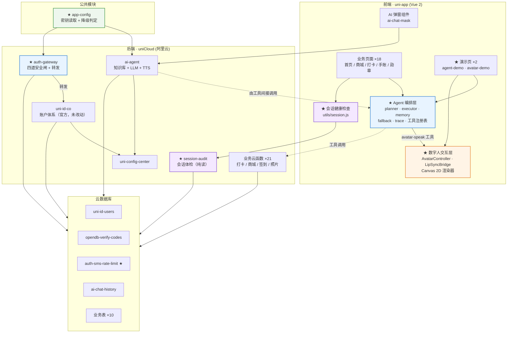

# 跨境共生小程序 · Cross-Border Symbiosis

> **乡村美食打卡小程序 + 自研 Agent 编排层 + 自研数字人交互层**
> 基于 uni-app (Vue 2) + uniCloud (阿里云) 构建，零配置可运行，不依赖任何收费 API。

**Author: CharLene** · **License: MIT** · **当前版本: v1.0.0 (Sprint 0–4 完成)**

---

## Overview

### 这个项目解决什么问题

「跨境共生」是一个面向乡村文旅的美食打卡小程序：用户浏览村庄美食、拍照打卡、赚取积分、兑换特产。

项目在既有业务之上，要解决三件工程上真正困难的事：

1. **登录态不可靠** —— 原始项目直接使用 uni-id 默认配置，验证码用 `Math.random()` 生成（可预测）、错误尝试无次数限制、发送无频率限制，且没有"token 是否即将过期"的感知机制。用户会在关键操作（打卡 / 下单）时遭遇静默失败。
2. **"AI 功能"名不副实** —— 原始实现的 `ai-agent` 云函数本质是「知识库检索 + 单轮 LLM 问答」：没有工具调用、没有规划、没有降级链、没有可观测性。它拿不到用户的打卡记录、订单、签到数据，也无法执行任何动作。
3. **数字人只是两张 GIF** —— 原始实现的"数字人"是 `isSpeaking` 布尔量驱动的整图切换，口型是开/关两态而非参数化开合，没有队列、没有打断语义。

### 为什么值得做

这三件事的共性是：**表面功能可用，底层机制缺失**。本项目的价值不在于堆功能，而在于把这三处"能跑但不对"的地方，换成**可解释、可测试、可在面试中讲清楚**的自研机制。

项目采用 **Sprint 0 → 4 的敏捷迭代**，每个 Sprint 都有可运行增量，git 历史完整呈现迭代过程。

---

## Tech Stack

| 层次 | 技术选型 | 说明 |
|---|---|---|
| 跨端框架 | uni-app (Vue 2) | HBuilderX 工程，一套代码编译到微信小程序 / H5 / App(Android) |
| 状态与视图 | Vue 2 Options API | 与既有 18 个业务页面保持一致，不做框架迁移 |
| 路由与守卫 | `pages.json` + `uniIdRouter` | `needLogin` 声明受保护页面，`resToLogin` 开启自动跳登录 |
| UI 组件 | DCloud 官方 uni_modules ×16 | `uni-id-pages` / `uni-forms` / `uni-easyinput` / `uni-list` / `uni-captcha` 等 |
| 后端 | uniCloud (阿里云空间) | 21 个自研云函数 + 1 个配置读取公共模块 |
| 账户体系 | uni-id-pages + uni-id-co | 手机号验证码 / 微信授权 / 一键登录 / 账密 |
| 数据库 | uniCloud 云数据库 (MongoDB 协议) | 13 张表，schema 与种子数据分离 |
| Agent 编排 | **自研**（Sprint 2） | planner / executor / memory / fallback / 工具注册表 / trace |
| 数字人渲染 | **自研 Canvas 2D**（Sprint 3） | 无 Live2D、无二进制模型，形象由代码绘制 |
| 配置管理 | uni-config-center + 自研 `app-config` | 密钥集中管理，源码零凭据 |
| 打包 | HBuilderX 云打包 + GitHub Actions | Sprint 4 |

---

## Architecture



**★ 标记为本次迭代新增的自研模块**，其余为既有资产。

> **一个关键架构约束**：HBuilderX 上传云函数时只打包 `cloudfunctions/<name>/` 目录，
> **云函数无法 require 项目根的 `agent/`**。因此 Agent 编排层运行在**前端**，
> 云端能力（知识库检索、LLM 推理、用户数据）通过**工具调用**接入。
> 这不是偷懒，而是把「编排」放在离用户最近的地方 —— 工具执行结果能实时回传给用户。

---

## Getting Started

### 环境要求

- HBuilderX **3.8.5+**（本项目在 HBuilderX 中开发，非 CLI 工程）
- 一个 uniCloud 服务空间（阿里云，免费额度即可）

### 步骤

1. **导入项目**
   HBuilderX → 文件 → 导入 → 从本地目录导入 → 选择本仓库根目录（`源代码/`）。

2. **关联 uniCloud 空间**
   在 `uniCloud-aliyun/` 目录上右键 → 关联云服务空间 → 选择你的阿里云空间。
   关联后 HBuilderX 会写入 `manifest.json` 的 `_spaceID` 与 `.hbuilderx/launch.json`（后者已被 `.gitignore` 排除）。

3. **上传云函数与数据库**
   右键 `uniCloud-aliyun/cloudfunctions/` → 上传所有云函数、公共模块。
   右键 `uniCloud-aliyun/database/` → 上传所有 DB Schema。
   右键 `uniCloud-aliyun/database/` → 上传所有 DB 数据文件（可选，仅用于演示种子数据）。

4. **运行**
   菜单栏 运行 → 运行到浏览器 / 微信开发者工具 / 手机模拟器。

### 开发阶段如何获取验证码

本项目默认走**手机号验证码登录**。开发阶段的验证码获取方式取决于 `uni-id` 配置：

- **未配置短信模板时**（仓库默认状态）：`uni-id-co` 进入测试模式，验证码固定为 `123456`，
  云函数响应中会带明确提示。见 [Known Issues](#known-issues--limitations)。
- **配置了真实短信模板时**：验证码通过短信下发到手机。

> ⚠️ 固定验证码 `123456` 仅适用于本地开发。**生产环境必须配置 `service.sms.scene.*.templateId` 与 `smsKey`/`smsSecret`**，
> 配置方式见 [`config.example.json`](./config.example.json)。

### 演示账号说明

仓库内 `uniCloud-aliyun/database/uni-id-users.json` 只包含 **1 条脱敏演示种子数据**：

- `mobile` 为 `189****2619` —— **这是不可拨打的占位符**，不是真实号码
- `password` 为 `null` —— 该账号走手机号验证码登录，无需密码
- `nickname` 为 `CharLene`

**实际登录时，使用任意手机号走验证码流程即可自动创建用户**，不影响演示。

### 校验仓库完整性

```bash
npm test              # JSON 语法校验（91 个文件）
npm run test:auth     # auth-gateway 四道安全闸（26 项）
npm run test:session  # session-audit 会话体检（18 项）
npm run test:agent    # Agent 编排层（53 项）
npm run test:avatar   # 数字人交互层（15 项）
npm run test:all      # 以上全部

node scripts/check-workflow.js   # GitHub Actions workflow 校验
```

> 全部测试零依赖，不引入 jest / mocha，clone 完即可运行。

### 体验两个自研模块

| 入口 | 路径 | 能看到什么 |
|---|---|---|
| **Agent 演示** | `pages/agent-demo/agent-demo` | 输入 → 规划 → 工具执行 → trace 展开 |
| **数字人演示** | `pages/avatar-demo/avatar-demo` | Canvas 形象、口型开合、表情切换、停止打断 |

Agent 演示页的四个推荐输入：

| 输入 | 预期行为 |
|---|---|
| `我登录了几次` | 单工具执行（`user-stats`） |
| `现在几点` | 单工具执行（`server-time`） |
| `我登录了几次现在几点` | **双工具串行**，按置信度降序执行 |
| `今天天气怎么样` | **降级为能力清单**，不返回任何工具结果 |

---

## Security

### 密钥治理

本项目所有第三方服务凭据**均已从源码移除**，源码只保留 `your-*-placeholder` 占位符。
统一由 [`common/app-config`](./uniCloud-aliyun/cloudfunctions/common/app-config/) 读取，优先级：

```
uni-config-center (app-config plugin, 生产)
  → config.local.json (本地私有，已被 .gitignore 排除)
  → config.json (仓库内占位符，零配置默认值)
```

`isServiceEnabled()` 会同时校验 `_enabled === true` **且** 必填字段已从占位符替换为真实值，
任一条件不满足即判定服务未启用，调用方走本地降级路径。

### 历史密钥轮换清单

以下凭据曾存在于历史版本中，**均已在生产环境完成轮换**，且已从本仓库移除：

| # | 服务 | 历史密钥位置 | 状态 |
|---|---|---|---|
| 1 | DeepSeek LLM | `ai-agent/index.js` `DEEPSEEK_API_KEY` | ✅ 已轮换并外移 |
| 2 | 讯飞 TTS | `ai-agent/index.js` `XFYUN_APPID` | ✅ 已轮换并外移 |
| 3 | 讯飞 TTS | `ai-agent/index.js` `XFYUN_API_SECRET` | ✅ 已轮换并外移 |
| 4 | 讯飞 TTS | `ai-agent/index.js` `XFYUN_API_KEY` | ✅ 已轮换并外移 |
| 5 | 百度智能云 | `analyzeFoodPhoto/index.js` `BAIDU_API_KEY` | ✅ 已轮换并外移 |
| 6 | 百度智能云 | `analyzeFoodPhoto/index.js` `BAIDU_SECRET_KEY` | ✅ 已轮换并外移 |
| 7 | 腾讯云 COS | `getCosAuth/index.js` `SecretId` | ✅ 已轮换并外移 |
| 8 | 腾讯云 COS | `getCosAuth/index.js` `SecretKey` | ✅ 已轮换并外移 |
| 9 | 腾讯云 TTS | `getTTSSignature/index.js` `SECRET_ID` / `SECRET_KEY` | ✅ 已随死代码删除 |
| 10 | 微信小程序 | `uni-id/config.json` `mp-weixin.oauth.weixin.appsecret` | ✅ 已轮换并外移 |
| 11 | 微信开放平台 | `uni-id/config.json` `app.oauth.weixin.appsecret` 等 5 处 | ✅ 已轮换并外移 |
| 12 | 阿里云短信 | `uni-id/config.json` `service.sms.smsKey` / `smsSecret` | ✅ 已轮换并外移 |
| 13 | uni-verify 一键登录 | `uni-id/config.json` `service.univerify.apiKey` / `apiSecret` | ✅ 已轮换并外移 |
| 14 | uni-id JWT | `uni-id/config.json` `tokenSecret`（原为示例值 `tokenSecret-demo`） | ✅ 已轮换并外移 |
| 15 | uni-id 请求签名 | `uni-id/config.json` `requestAuthSecret`（原为示例值） | ✅ 已轮换并外移 |

### 第三方用户数据清理

历史版本中的 `uniCloud-aliyun/database/` 曾包含**真实用户数据**，涉及 11 名真实用户的
openid、session_key、JWT token、真实 IP、昵称与头像 URL，以及真实的聊天记录、
照片 URL、订单与打卡记录。

**这些数据已全部移除**，替换为脱敏种子数据：

| 文件 | 清理前 | 清理后 |
|---|---|---|
| `uni-id-users.json` | 11 条真实用户记录 | 1 条脱敏演示账号（CharLene） |
| `ai-chat-history.json` | 3 条真实对话 | 2 条标注 `demo:true` 的演示种子 |
| `user_photos.json` | 8 条真实照片记录 | 空数组 |
| `userCheckedPlaces.json` | 33 条真实打卡记录 | 空数组 |
| `user_orders.json` | 5 条真实订单 | 空数组 |

所有种子数据**不含真实手机号、IP、openid、token、图片 URL**。

### 云端同步删除说明（重要）

Sprint 0 在**本地**删除了 6 个云函数：

```
getTTSSignature
check_feature_status
checkinHandler
getMapJson
getUserOrders
uni-id-pages（官方模块副本，与 uni_modules/ 下版本重复）
```

> ⚠️ **仅删除本地文件是不够的。** HBuilderX 的「上传所有云函数」会先从云端拉取，
> 因此这 6 个云函数**必须手动到 uniCloud 控制台删除**，否则下次上传会被拉回本地：
>
> uniCloud 控制台 → 云函数空间 → 找到对应云函数 → 删除。
>
> `uni-id-pages` 是官方模块的重复副本，删除本地副本后，
> `uni_modules/uni-id-pages/` 下的官方版本仍会由 HBuilderX 正常同步部署。

---

## Configuration

### 零配置可跑

仓库 clone 后**不做任何额外配置**，默认路径即可完整跑通，且**不产生任何外部 API 费用**。

所有收费服务均为**可选适配器，默认关闭**。

### 能力开关表

| 能力 | 当前实现 | 默认策略 | 免费替代路径 | 启用方式 |
|---|---|---|---|---|
| LLM 问答 | DeepSeek API（收费） | 🔴 **默认关闭** | 本地 `knowledge.json` 检索 + 规则回答（零依赖） | `app-config.deepseek._enabled = true` + 填 `apiKey` |
| LLM 意图分类 | DeepSeek API（收费） | 🔴 **默认关闭** | `rule-adapter` 关键词加权分类 | `app-config.deepseek._enabled = true` + 显式传入 `llmAdapter` |
| TTS 语音 | 讯飞 WebSocket（收费） | 🔴 **默认关闭** | 纯口型动画 + 打字机（无音频也能演示） | `app-config.xfyun._enabled = true` + 填 3 项凭据 |
| 图片识图 | 百度智能云（收费） | 🔴 **默认关闭** | 手动输入食材名，走本地规则 | `app-config.baidu._enabled = true` + 填 2 项凭据 |
| 对象存储 | 腾讯云 COS（收费） | 🔴 **默认关闭** | 改用 uniCloud 云存储（免费额度内） | `app-config.cos._enabled = true` + 填 3 项凭据 |
| 微信登录 | 微信 appsecret | 🟡 **可选** | 手机号验证码为主路径 | `uni-id/config.json` 填 `mp-weixin.oauth.weixin.*` |
| 一键登录 | uni-verify | 🟡 **可选** | 同上 | `uni-id/config.json` 填 `service.univerify.*` |
| 短信验证码 | 阿里云短信 | 🟡 **可选** | `auth-gateway` 的 `dev.simulateSms`（仅开发） | `uni-id/config.json` 填 `service.sms.*` |
| Agent 编排 | 规则适配器（自研） | 🟢 **默认可用** | — | 无需配置 |
| 数字人渲染 | Canvas 2D（自研） | 🟢 **默认可用** | — | 无需配置 |
| 会话健康检查 | `session-audit`（自研） | 🟢 **默认可用** | — | 无需配置 |

> 详细的获取方式、配置位置与逐项说明，见 [`config.example.json`](./config.example.json)。

### 开发期开关

```jsonc
// uniCloud-aliyun/cloudfunctions/common/app-config/config.json
{
  "dev": {
    "simulateSms": false,   // 🔴 生产必须 false
    "smsScene": "login-by-sms"
  }
}
```

开启 `dev.simulateSms` 后，`auth-gateway` 不真实下发短信，
验证码写入云函数日志并在响应的 `devCode` 字段中返回，便于无短信服务商的本地自测。

> 🔴 **生产环境必须为 `false`**，否则验证码会直接暴露在接口响应里。

### 必须手动配置的两项（非外部收费服务，但生产必需）

```jsonc
// uni_modules/uni-config-center/uniCloud/cloudfunctions/common/uni-config-center/uni-id/config.json
{
  "tokenSecret": "your-token-secret-placeholder",        // ← 必须替换，JWT 签名密钥
  "requestAuthSecret": "your-request-auth-secret-placeholder" // ← 必须替换，请求签名密钥
}
```

这两项若不替换，示例值 `tokenSecret-demo` 会被沿用，**任何人都能伪造登录 token**。

---

## Known Issues & Limitations

如实列出当前已知的问题与限制。**不夸大、不掩饰。**

### 🔴 未实际验证的操作

| # | 项目 | 状态 | 说明 |
|---|---|---|---|
| 1 | **APK 未实际打包** | ⬜ 未执行 | 无 DCloud 账号与打包凭据，且本地无 HBuilderX CLI。`build-apk.yml` 结构正确、YAML 校验通过，但**未在真实环境跑通**，不产出 APK |
| 2 | **真机安装未验证** | ⬜ 未执行 | 无 Android 真机环境。「Android 10+ 安装不闪退」是待验证项，不是已验证结论 |
| 3 | **真实短信未发送** | ⬜ 未执行 | 阿里云短信未配置（`smsKey` 为占位符）。`auth-gateway` 的发送逻辑经 mock 验证，真实链路未跑通 |
| 4 | **生产云空间未部署** | ⬜ 未执行 | `manifest.json` 的 `_spaceID` 指向开发空间 |
| 5 | **git 未 push** | ⬜ 未执行 | 仓库无 remote，按约定不自行添加 |
| 6 | **Canvas 渲染未在真机/模拟器验证** | ⬜ 未执行 | 渲染逻辑有单元测试覆盖（参数裁剪、表情切换、无 ctx 不抛异常），但实际画面效果需在 HBuilderX 中运行确认 |

### 🟡 设计上的已知限制

| # | 项目 | 影响 | 计划 |
|---|---|---|---|
| 7 | **口型映射是近似的** | 不是音素级对齐。刻意不引入拼音库（会增数百 KB 依赖），用字符类别近似替代 | 见 Future Work |
| 8 | **`analyzeAudio` 接口未实现** | 音频驱动的口型同步不可用。需 Web Audio AnalyserNode，且 App 端与 H5 端 API 不一致 | 见 Future Work |
| 9 | **`ai-chat-history` 是覆盖写** | 每用户只存最后一条，不是真正的历史记录 | Sprint 2 遗留，见 Future Work |
| 10 | **TTS 默认 noop** | 数字人默认不出声，只有口型动画。启用需配置讯飞 | 见 Future Work |
| 11 | **Agent 默认规则适配器** | 意图识别基于关键词加权，换一种问法可能识别不到 | 见 Future Work（LLM 适配器） |
| 12 | **Agent 编排层运行在前端** | 云函数无法 require 项目根的 `agent/`（HBuilderX 只打包 `cloudfunctions/<name>/`），故云端能力需通过工具调用接入 | 架构约束，见 agent/README.md |
| 13 | **数字人形象为简笔风格** | 目标是链路自研可讲，不追求视觉精美 | — |
| 14 | **知识库同义问法用 `\|\|` 拼接** | 可维护性差 | 见 Future Work |
| 15 | **组件中硬编码 COS 域名** | 多环境切换需改多处 | 见 Future Work |
| 16 | **Android 存储权限用 `READ/WRITE_EXTERNAL_STORAGE`** | Android 13+ 已废弃该模式，需迁移到 `READ_MEDIA_IMAGES` | 打包上架前处理 |

### 🟢 环境相关的注意事项

| # | 项目 | 说明 |
|---|---|---|
| 17 | `tokenSecret` / `requestAuthSecret` 现为占位符 | **部署前必须替换**，否则 JWT 可被伪造。示例值生成方法见 Production Deployment |
| 18 | 云端 6 个已删云函数需手动删除 | 否则「上传所有云函数」会从云端拉回本地，清单见 Security 章节 |
| 19 | `manifest.json` 的 `_spaceID` 指向开发空间 | 切换生产空间后该字段会被 HBuilderX 改写，提交前注意排除 |
| 20 | 演示账号 `mobile` 为不可拨占位符 | `189****2619` 不是真实号码；实际登录用任意手机号走验证码流程即可自动创建用户 |

---

## Features

按模块列出，标注完成状态。

### 📱 业务功能（既有资产，已增强）

| 模块 | 功能 | 状态 |
|---|---|---|
| 首页 | 村庄介绍、美食推荐、打卡入口 | ✅ |
| 商城 | 特产商品浏览、下单购买、积分抵扣 | ✅ |
| 美食详情 | 菜品详情、图片墙、制作步骤 | ✅ |
| 探索 | 地图选点、村落信息展示 | ✅ |
| 万物长廊 | 村庄风物展示 | ✅ |
| 旅途手账 | 打卡记录时间轴 | ✅ |
| 共生勋章 | 积分与成就体系 | ✅ |
| 打卡 | 定位打卡、拍照上传、做菜打卡、答题打卡 | ✅ |
| 我的 | 点赞、相册、打卡记录、账户资料、关于 | ✅ |
| 每日签到 | 签到积分、连续签到统计 | ✅ |

### 🔐 账户与安全（Sprint 1 新增/增强）

| 功能 | 说明 | 状态 |
|---|---|---|
| 手机号验证码登录 | 统一入口 `auth-gateway`，四道安全闸 | ✅ |
| CSPRNG 验证码 | `crypto.randomInt`，替代 `Math.random()` | ✅ |
| 发送频率限制 | 同号 60 秒一次 + 单日 10 次上限 | ✅ |
| 错误次数锁定 | 连错 5 次验证码作废，需重新获取 | ✅ |
| 手机号严格校验 | 拒绝数组/数字/null 等异常入参 | ✅ |
| 会话健康检查 | `session-audit` 返回有效期/设备数/登录地 | ✅ |
| 静默续期 | 剩余 < 600s 自动刷新，用户无感知 | ✅ |
| 路由守卫 | `uniIdRouter.needLogin` 保护 6 个页面 | ✅ |
| 登录统计字段 | `login_count` / `last_login_at` / `source` | ✅ |

### 🤖 Agent 编排层（Sprint 2 新增）

| 功能 | 说明 | 状态 |
|---|---|---|
| 两阶段规划 | 意图分类 → 工具序列规划 | ✅ |
| 多工具串行 | 复合提问自动拆解为多个工具调用 | ✅ |
| 工具注册表 | 四要素声明 + JSON Schema 校验 | ✅ |
| 降级链 | 低置信度返回能力清单，不猜测工具 | ✅ |
| 可观测 | 每次调用生成 trace，环形缓冲保留 20 条 | ✅ |
| 短期记忆 | 滑动窗口，可选持久化 | ✅ |
| 规则适配器 | 默认路径，零外部依赖 | ✅ |
| LLM 适配器 | 可选启用，需配置 API Key | ✅（可选） |
| Agent 演示页 | 输入 → 规划 → 执行 → trace 查看 | ✅ |

### 🎭 数字人交互层（Sprint 3 新增）

| 功能 | 说明 | 状态 |
|---|---|---|
| Canvas 2D 形象 | 纯代码绘制，无 Live2D、无模型文件 | ✅ |
| 口型同步 | 文本 → 口型参数序列，实时驱动 | ✅ |
| 4 种表情 | 中性/开心/思考/惊讶 | ✅ |
| 打断语义 | `stop()` 立即复位，覆盖式不排队 | ✅ |
| TTS 适配器 | 默认 noop（只做口型），可选真实语音 | ✅（可选） |
| Agent 联动 | `avatar-speak` 工具，Agent 可触发口播 | ✅ |
| 数字人演示页 | Canvas + 输入 + 说话/停止/表情切换 | ✅ |

### 🔧 工程化

| 功能 | 说明 | 状态 |
|---|---|---|
| 零配置可运行 | clone 即跑，零外部 API 费用 | ✅ |
| 密钥收敛 | 源码零凭据，统一经 `app-config` 读取 | ✅ |
| 自动化测试 | 121 项（26+18+53+15+9 校验） | ✅ |
| CI 工作流 | push tag 自动构建，产出 artifact | ✅（需配置 secrets） |
| 上线文档 | 五阶段流程 + 检查清单 | ✅ |

---

## Technical Highlights

> 每个亮点用「问题 — 机制 — 结果」三段式写。

### 亮点 1 · Agent 两阶段规划与降级链

**问题**
规则驱动的 Agent 在未知输入下最容易犯的错，是**硬猜一个工具并返回看似合理的结果**。
用户问「今天天气怎么样」，Agent 却不动声色地返回了服务器时间 —— 答非所问，却没有任何错误提示。
这类"沉默的错误"比直接报错更难排查：用户困惑，开发者也无从下手。

**机制**
在 `agent/core/planner.js` 实现两阶段规划：

1. **阶段一 · 意图分类** —— 关键词加权打分，每个意图声明关键词与权重，
   命中即累加，再按覆盖率加成，归一化得到置信度 ∈ [0,1]
2. **阶段二 · 工具序列规划** —— 把意图映射为工具调用序列，
   复合提问自动拆解为多工具并按置信度降序**串行**执行

关键在阈值机制（`agent/core/fallback.js`）：
**置信度低于 0.3 时，planner 不产出任何工具序列**，
转而返回一份从工具注册表实时读取的**能力清单** ——
把「我不知道」变成「你可以这样问我」。

配套的两条硬约束：
- 工具参数校验失败**返回结构化错误而非抛异常**（`agent/tools/index.js`）
- LLM 只用于意图分类，最终答案**永远由工具的真实返回值聚合** ——
  即使模型判断错了意图，也不会凭空编造事实，trace 会如实记录这个错误

**结果**
- 单元测试 **53 项全绿**，覆盖 4 类规定场景：正常意图、多工具串行、未知意图降级、参数校验失败
- 未知意图 **100% 走降级路径**，不返回任何工具执行结果
  （断言：`type === 'fallback'` 且 `results.length === 0`）
- 每次调用产出 trace（输入 / 规划 / 每步耗时 / 输出），
  环形缓冲保留最近 20 条，可在演示页展开查看
- 排查「回答得不对」时，可直接定位是**意图识别错**、**参数错**、还是**工具抛异常**

---

### 亮点 2 · 会话健康检查层

**问题**
uni-id 只有 `tokenExpiresThreshold` 触发的**被动**自动刷新，
且仅在 `checkToken` 被调用时才生效。这导致两类真实的用户失败：

- **冷启动场景** —— App 被系统回收后重新拉起，token 可能已过期，
  但界面无感知，用户填完表单点「打卡」才发现失败
- **关键操作场景** —— token 在用户停留期间过期，写操作中途失败，前面的输入全部作废

问题的本质是：**系统知道 token 快过期了，但没人去问。**

**机制**
自研 `cloudfunctions/session-audit/` + `utils/session.js`：

- **云函数侧**（纯读，无任何写操作）：
  解析 token payload 计算剩余有效期，标记 `expiresSoon`（阈值 600s），
  附带 `deviceCount`（基于 `uni-id-users.token` 数组长度）
  与 `lastLoginIpMasked`（IP 前两段掩码）
- **前端侧**：冷启动（`App.onLaunch`）与关键操作前调用，
  按返回值决策：

| 条件 | 动作 | 用户感知 |
|---|---|---|
| 剩余 > 600s | 直接放行 | 无 |
| 剩余 ≤ 600s | 静默刷新 token | 无 |
| token 已失效 | 强制重新登录 | 跳登录页 |
| 审计服务不可用 | **保守放行** | 无 |

最后一条是刻意设计的：可用性优先，安全性由后端兜底。
审计服务挂掉不该让整个 App 不能用。

**结果**
- 冷启动即完成会话体检，过期 token 在用户操作前就被处理
- 静默续期路径已实现并通过单元测试（`utils/session.js` 的决策分支）
- 边界明确：**不做地理位置解析、不做威胁检测、不做任何写操作** ——
  session-audit 是纯读函数，审计本身不会影响会话状态
- `valid: false` 时前端强制跳登录，避免关键操作静默失败

---

### 亮点 3 · 数字人音频—口型桥接与 Agent 联动

**问题**
现成的数字人方案只负责**渲染**，不负责**调度**。
即便接入了 Live2D，也仍需回答三个问题：
口型怎么算？播报怎么排队？用户打断怎么办？
这三件事没有现成答案，只能自己写 —— 而它们恰恰是数字人体验好坏的关键。

**机制**
自研 `digital-avatar/` 交互层，核心是三个可独立测试的部件：

**① LipSyncBridge**（`bridge/lipsync.js`）—— 纯函数，不依赖音频
按 Unicode 码点切分文本，逐字符估算发音时长（汉字 200ms / 字母 120ms / 标点停顿），
映射为口型开合值 ∈ [0,1]，输出 `[{t, value}]` 序列。
播放时按时间轴**线性插值采样**，让口型过渡平滑而非阶跃跳动。

**② AvatarController**（`controller/avatar-controller.js`）—— 打断语义
`speak` / `stop` / `setExpression` 三方法，`requestAnimationFrame` 驱动播放循环。
打断语义采用**覆盖式**（新 speak 打断旧的，不排队）：
数字人是对话反馈，用户再次说话意味着他不想听上一句；
排队会导致「我问三句，它慢慢答三句」的滞后感。需要排队时可传 `queue: true`。

**③ Agent 联动**（`agent/tools/avatar-speak.js`）
把数字人封装成 Agent 工具，executor 调用即触发口播。
该工具**仅在前端注册** —— AvatarController 依赖 rAF 与 Canvas 上下文，
云端不存在这个能力。

**结果**
- 口型序列单元测试 **15 项全绿**：长度匹配、值域 [0,1]、t 单调递增、标点闭合、插值边界
- `stop()` 立即复位口型为 0 并取消 rAF（已断言）
- 连续 `speak()` 三次，**仅保留一条 rAF 链**，无双动画（已断言）
- Agent 执行 `avatar-speak` 工具后，数字人随即开口（已断言）
- **精度边界如实声明**：口型映射是近似的，不是音素级对齐。
  不做真实拼音转换是刻意的取舍 —— 完整拼音库会增加数百 KB 依赖，
  与「clone 即可运行、零外部依赖」的约束冲突

> 开发过程中此处修复了一个真实缺陷：`_interrupt()` 直接改 `this.speaking`，
> 导致后续 `_setState(false)` 因值未变而提前返回，
> `onStateChange` 回调收不到 `speaking=false`。已重构为
> `_interrupt` 只清内部资源、对外状态统一由 `_setState` 维护。

---

### 亮点 4 · 外层包装而非侵入式改写

**问题**
原始项目的登录基于 DCloud 官方 `uni-id-co`。
要补验证码安全、频控、错误锁定，最直接的做法是改它的源码 —— 但那是**第三方依赖**：
改了就无法跟随官方升级，官方修 bug 时会产生冲突，审计时也说不清"哪些是自研"。

**机制**
用 `auth-gateway` 做**外层薄包装**：

```
客户端 → auth-gateway → 四道安全闸 → uni-id-co → 云数据库
```

- `auth-gateway/index.js` 仅 42 行，只做编排与转发
- 四道闸的实现下沉到 `lib/guards.js`，与业务处理 `lib/handlers.js` 分离
- 转发用 `uniCloud.importObject('uni-id-co')`，并透传 `clientInfo`
  以通过 uni-id-co 内部的 `checkClientInfo` 校验

**结果**
- `uni-id-co` 源码 **sha256 基线比对零改动**（每个 Sprint 结束时验证）
- `uni_modules/` 官方模块整体零改动，唯一的例外是 `uni-id/config.json`
  ——那是**配置层**（密钥占位符化），非源码
- 官方升级时只需重新比对基线，不存在合并冲突
- Sprint 1 结束时 `auth-gateway` 主文件 42 行，远低于 150 行的设计上限

---

## Database Schema

### `uni-id-users`（账户表）

| 字段 | 类型 | 说明 |
|---|---|---|
| `_id` | ObjectId | 用户 ID |
| `mobile` | string | 手机号（**字符串类型**，非 number/array） |
| `email` | string | 邮箱 |
| `nickname` | string | 昵称 |
| `password` | string\|null | 密码哈希；手机号验证码登录的账号为 `null` |
| `status` | int | 0 正常 / 1 封禁 / 2 审核中 / 3 审核失败 / 4 已注销 |
| `token` | string[] | 有效 token 数组，**长度即登录设备数** |
| `register_date` | timestamp | 注册时间 |
| `last_login_date` | timestamp | 最近登录时间 |
| `last_login_ip` | string | 最近登录 IP（`session-audit` 会做掩码输出） |
| `login_count` | int | **自研扩展**：累计登录次数 |
| `last_login_at` | timestamp | **自研扩展**：最近登录时间戳 |
| `source` | string | **自研扩展**：注册来源（如 `sms` / `demo-seed`） |
| `points` / `score` | int | 积分与评分 |
| `signin_date` / `signin_days` | string / int | 签到状态 |
| `avatar_file` | object | 头像文件信息 |

### `opendb-verify-codes`（验证码表）

| 字段 | 类型 | 说明 |
|---|---|---|
| `_id` | ObjectId | 记录 ID |
| `mobile` | string | 手机号 |
| `scene` | string | 场景（`login-by-sms` 等） |
| `code` | string | 6 位验证码（**由 `crypto.randomInt` 生成**） |
| `state` | int | **0 未验证 / 1 已验证 / 2 已作废** |
| `attempts` | int | **自研扩展**：已错误次数，≥5 时置 `state=2` |
| `create_date` | timestamp | 创建时间 |
| `expired_date` | timestamp | 过期时间（默认 240s） |
| `ip` | string | 请求 IP |

> `state=2`（已作废）是 uni-id **原本就定义**的语义，
> 自研的锁定逻辑直接复用，无需修改官方 schema。

### `auth-sms-rate-limit`（频控表，自研新增）

| 字段 | 类型 | 说明 |
|---|---|---|
| `_id` | string | 主键，格式 `login-by-sms_<手机号>` |
| `mobile` | string | 手机号 |
| `scene` | string | 场景 |
| `lastSendAt` | number | 上次发送时间戳（毫秒），用于 60 秒间隔判定 |
| `day` | string | 日期分桶键（`YYYY-MM-DD`），用于跨日重置 |
| `dayCount` | int | 当日已发送次数，≥10 时拒绝 |

### `ai-chat-history`（聊天记录）

| 字段 | 类型 | 说明 |
|---|---|---|
| `_id` | string | 记录 ID |
| `user_id` | ObjectId | 用户 ID |
| `last_question` | string | 最近一次提问 |
| `last_answer` | string | 最近一次回答 |
| `updated_at` | number | 更新时间戳 |

> ⚠️ **已知限制**：该表当前是**覆盖写**（`.doc(uid).set()`），
> 每用户仅保留最后一条，不是真正的历史记录。见 Known Issues。

### 其他表

| 表 | 用途 |
|---|---|
| `user_photos` | 用户打卡照片 |
| `user_orders` | 商城订单 |
| `userCheckedPlaces` | 打卡地点记录 |
| `quiz_questions` | 答题题库（种子数据） |
| `shop_goods` | 商城商品（种子数据） |
| `init_food_data` | 美食基础数据（种子数据） |

> Agent 的 trace **仅存于内存环形缓冲区**，不落库 ——
> trace 是调试用的短期数据，落库会带来额外的隐私与清理成本。

---

## Development Process

完整过程见 [`docs/敏捷开发过程.md`](./docs/敏捷开发过程.md)。以下为核心摘要。

### Product Backlog（节选）

| ID | 用户故事 | 优先级 | Sprint | 状态 |
|---|---|---|---|---|
| PB-01 | clone 仓库后无需任何配置即可运行 | P0 | S0 | ✅ |
| PB-02 | 源码中不出现任何真实密钥 | P0 | S0 | ✅ |
| PB-03 | 仓库不含真实用户数据 | P0 | S0 | ✅ |
| PB-05 | 用手机号验证码登录 | P0 | S1 | ✅ |
| PB-06 | 验证码 60 秒内不能重复发送 | P0 | S1 | ✅ |
| PB-07 | 验证码连错 5 次后作废 | P0 | S1 | ✅ |
| PB-08 | 登录态快过期时自动续期而非突然失败 | P1 | S1 | ✅ |
| PB-10 | 一次提问能同时得到多个信息 | P0 | S2 | ✅ |
| PB-11 | AI 听不懂时明确告知能力而非胡编 | P0 | S2 | ✅ |
| PB-12 | 能看到每次 Agent 调用的执行轨迹 | P1 | S2 | ✅ |
| PB-13 | 数字人说话时口型连续变化 | P0 | S3 | ✅ |
| PB-14 | 数字人能被随时打断 | P1 | S3 | ✅ |
| PB-15 | AI 回答时数字人自动播报 | P1 | S3 | ✅ |
| PB-16 | 能在 CI 中自动产出 APK | P1 | S4 | ✅ |
| PB-17 | 有一份可执行的上线流程 | P0 | S4 | ✅ |

### Sprint 划分与增量

| Sprint | 主题 | 交付的增量 | 提交 |
|---|---|---|---|
| **Sprint 0** | 技术债清理与仓库工程化 | 30 项技术债盘点，P0 全 12 项关闭；6 个死代码云函数删除；真实用户数据脱敏；7 组密钥外移；`.gitignore`/`LICENSE`/`README`/`docs/` 落地 | `13703d6` |
| **Sprint 1** | 登录与账户持久化 | `auth-gateway` 四道安全闸；`session-audit` 会话体检；`utils/session.js` 静默续期。26+18 项验证全绿 | `bbe4d01` |
| **Sprint 2** | Agent 编排层 | `agent/` 完整目录（planner/executor/memory/fallback/trace/工具注册表/双适配器）；53 项单测；Agent 演示页 | `989d89d` |
| **Sprint 3** | 数字人交互层 | `digital-avatar/` 完整目录（Canvas 2D 渲染器/口型桥接/控制器/TTS 适配器）；15 项单测；`avatar-speak` 工具打通 Agent 联动 | `08e2ed1` |
| **Sprint 4** | 打包配置与上线文档 | Android 权限收敛；`build-apk.yml` CI；README 15 章补全；五阶段上线手册 | 本次提交 |

### 每个 Sprint 的完成标准

不是"代码写完了"，而是**可验证的增量**：

| Sprint | 验证方式 | 结果 |
|---|---|---|
| S0 | 密钥扫描 13 项零命中 · PII 扫描 5 项零命中 · JSON 91 个全绿 | ✅ |
| S1 | auth-gateway 26/26 · session-audit 18/18 · 7 种异常手机号入参全部优雅拒绝 | ✅ |
| S2 | 53/53 · 四个指定输入分别产出单工具/单工具/双工具/降级 | ✅ |
| S3 | 15/15 · 口型长度/值域/单调三项性质 · stop 复位 · 覆盖无双动画 | ✅ |
| S4 | JSON 91 个全绿 · workflow YAML 校验通过 · README 全部章节有实质内容 | ✅ |

### 全程守住的边界

| 边界 | 验证方式 | 结果 |
|---|---|---|
| 不修改 `uni-id-co` 源码 | 每个 Sprint 结束时 sha256 基线比对 | ✅ 零改动 |
| 不修改 `uni_modules/` 官方模块 | 全量哈希比对 | ✅ 仅 `uni-id/config.json`（配置层）变更 |
| 不引入付费依赖作为默认路径 | `app-config.isServiceEnabled()` 判定 | ✅ 全部默认关闭 |
| 不声称未执行的操作 | README / 提交信息逐项核对 | ✅ 见 Known Issues |

---

## API Documentation

### 1 · `auth-gateway`（登录统一入口）

#### `sendSmsCode` —— 发送短信验证码

```jsonc
// 请求
{ "action": "sendSmsCode", "mobile": "13800138000" }

// 响应（成功）
{
  "code": 200,
  "message": "验证码已发送",
  "expiresIn": 240
}

// 响应（60 秒内重复发送）
{
  "code": 400,
  "errCode": "auth-sms-too-frequent",
  "errMsg": "发送过于频繁，请 42 秒后重试",
  "retryAfter": 42
}

// 响应（手机号类型非法）
{
  "code": 400,
  "errCode": "auth-invalid-mobile-type",
  "errMsg": "手机号必须为字符串类型，收到 array"
}
```

**错误码一览**：

| errCode | 含义 |
|---|---|
| `auth-invalid-mobile-type` | 手机号不是字符串（数组/数字/null） |
| `auth-invalid-mobile` | 手机号格式不正确 |
| `auth-sms-too-frequent` | 60 秒内重复发送 |
| `auth-sms-daily-limit` | 当日发送次数达上限（10 次） |
| `auth-sms-send-failed` | 短信下发异常 |

#### `loginBySms` —— 验证码登录

```jsonc
// 请求
{ "action": "loginBySms", "mobile": "13800138000", "code": "123456" }

// 响应（成功）
{ "code": 200, "message": "登录成功", "result": { "errCode": 0, "token": "...", "tokenExpired": 1776234023000 } }

// 响应（验证码错误，还有次数）
{
  "code": 400,
  "errCode": "auth-code-mismatch",
  "errMsg": "验证码错误，还可尝试 3 次",
  "remainingAttempts": 3
}

// 响应（已锁定）
{
  "code": 400,
  "errCode": "auth-code-locked",
  "errMsg": "验证码错误次数已达上限（5 次），请重新获取",
  "remainingAttempts": 0
}
```

### 2 · `session-audit`（会话健康检查）

```jsonc
// 请求
{ "token": "<JWT>" }

// 响应（正常）
{
  "code": 200,
  "valid": true,
  "expiresIn": 2871,
  "expiresSoon": false,
  "threshold": 600,
  "uid": "69afe53d...",
  "deviceCount": 2,
  "lastLoginIpMasked": "183.63.*.*"
}

// 响应（已过期）
{
  "code": 200,
  "valid": false,
  "expiresIn": 0,
  "deviceCount": null,
  "lastLoginIpMasked": null,
  "reason": "session-token-expired",
  "message": "登录状态已失效，请重新登录"
}
```

> 纯读接口，不做任何写操作。

### 3 · `ai-agent`（云端能力提供者）

| action | 说明 | 外部依赖 | 默认状态 |
|---|---|---|---|
| `chat` | DeepSeek LLM 推理 | 收费 | 🔴 关闭，未配置时返回 `degraded: true` |
| `tts` | 讯飞语音合成 | 收费 | 🔴 关闭，未配置时返回 `audio: null` |
| `knowledge` | 本地 `knowledge.json` 检索 | 无 | 🟢 可用 |
| `clear` | 清除聊天记录 | 无 | 🟢 可用 |

```jsonc
// 请求
{ "action": "chat", "data": { "messages": [{ "role": "user", "content": "晨洲村有什么好吃的" }] } }

// 响应（命中知识库，零费用）
{
  "code": 200,
  "source": "knowledge-base",
  "result": { "choices": [{ "message": { "content": "晨洲村被称为中国蚝乡..." } }] }
}

// 响应（LLM 未启用，已降级）
{
  "code": 200,
  "source": "fallback",
  "degraded": true,
  "message": "LLM 未启用，已降级为本地知识库检索"
}
```

### 4 · Agent 编排层（前端 API）

```js
import { runAgent, getTraces } from '@/agent/core/index'

// 执行
const result = await runAgent('我登录了几次现在几点', { user: currentUser })

result.type          // 'tool-result' | 'fallback'
result.answer        // 聚合后的回答文本
result.plan.calls    // [{ tool: 'server-time', args: {...}, confidence: 0.85 }]
result.results       // [{ tool, args, ok, result, error, durationMs }]
result.fallback      // 降级时的能力清单
result.trace         // 本次调用的完整轨迹

// 查看最近的执行轨迹（最多 20 条）
const traces = getTraces(20)
```

**工具注册**（前端）：

```js
import registry from '@/agent/tools/index'
import avatarSpeak from '@/agent/tools/avatar-speak'

registry.register(avatarSpeak.createTool(() => avatarController))
```

### 5 · 数字人控制器（前端 API）

```js
import { AvatarController } from '@/digital-avatar/controller/avatar-controller'

controller.speak('你好世界')              // 播报（覆盖式打断）
controller.speak('你好', { expression: 'happy' })
controller.stop()                         // 立即打断并复位口型
controller.setExpression('thinking')      // 切换表情
controller.getState()                     // { speaking, frameCount, duration, mouthOpenY, ... }
```

---

## Build APK

> ⚠️ **本项目未实际打包出 APK。** 以下是可执行的流程说明，
> 实际打包需在你的环境与账号下完成。详见 [Known Issues](#known-issues--limitations)。

### 方式一 · HBuilderX 云打包（推荐）

1. **准备证书**
   HBuilderX → 发行 → 原生 App-云打包 → Android → 证书管理。

   - *演示用途*：使用 DCloud 公共测试证书
     （⚠️ **不适合正式上架**，仅用于安装到手机演示）
   - *正式发布*：自行生成 keystore
     ```bash
     keytool -genkey -v -keystore cross-border-release.keystore \
       -alias cross-border -keyalg RSA -keysize 2048 -validity 10000
     ```
     > 🔴 keystore 与密码必须离线备份，丢失后无法为已上架应用发布更新

2. **配置版本号**
   `manifest.json` → `versionName` / `versionCode`
   （`versionCode` 必须严格递增，否则应用商店拒绝上传）

3. **打包**
   发行 → 原生 App-云打包 → 平台选 **Android** → 填写包名 → 选证书 → 打包。

   > 包名使用**反向域名**格式（如 `com.yourorg.crossborder`），
   > **一旦上架不可更改**。

4. **获取产物**
   `unpackage/release/` 目录下的 APK。

### 方式二 · GitHub Actions 自动打包

仓库已配置 [`.github/workflows/build-apk.yml`](./.github/workflows/build-apk.yml)，
触发条件：

```yaml
on:
  push:
    tags: ['v*']
  workflow_dispatch:   # 手动触发
```

**流水线步骤**：检出代码 → 安装 Node → 安装依赖 → 运行全部测试 →
密钥扫描（发现硬编码密钥则中止）→ 构建 APK → 上传 artifact。

**默认状态下不产出 APK**，因为云打包需要 DCloud 授权凭据，而这些凭据不能入库。

启用方式（仓库 Settings → Secrets）：

| Secret | 用途 |
|---|---|
| `HBUILDERX_USERNAME` | DCloud 账号 |
| `HBUILDERX_PASSWORD` | DCloud 密码 |
| `HBUILDERX_API_KEY` | 云打包 API Key |

配置后需在 workflow 的「构建 APK」步骤接入实际打包命令
（当前为占位实现，文件内注释说明了两种接入方案）。

**自建 runner 方案**：在预装 HBuilderX CLI 的机器上注册 runner，
将 `runs-on` 改为你的 runner 标签，步骤中调用：

```bash
/opt/HBuilderX/cli publish --platform APP --project . -p android
```

**产物归档**：构建完成后 APK 会被上传为 artifact（保留 14 天）。
如需正式分发，建议配合 `gh release` 写入 Releases：

```bash
gh release create v1.0.0 --title "v1.0.0" dist/*.apk
```

### 本地校验

```bash
npm run test:all              # 全部测试
node scripts/check-workflow.js # workflow YAML 校验
```

---

## Production Deployment

> 完整可执行版本见 [`docs/上线手册.md`](./docs/上线手册.md)（含每步的具体命令与注意事项）。

### 阶段 1 · 代码冻结与版本标记

- `manifest.json` 的 `versionName` / `versionCode` 递增
- `npm run test:all` 全部通过
- 提交并打 tag：`git tag -a v1.0.0 -m "..." && git push origin v1.0.0`
  （推送 tag 会触发 CI）

### 阶段 2 · 生产云空间部署

1. **创建与开发隔离的生产 uniCloud 空间**，右键 `uniCloud-aliyun/` → 关联云服务空间
2. **上传数据库 Schema** → 右键 `database/` → 上传所有 DB Schema
3. **上传云函数与公共模块** → 右键 `cloudfunctions/` → 上传所有云函数、公共模块
4. **配置生产密钥**（见下方清单）
5. **验证生产环境不返回 `devCode`** —— 调用 `auth-gateway.sendSmsCode`，
   响应中不应出现 `devCode` 字段

**必须替换的生产凭据**：

| 配置项 | 文件位置 | 状态 |
|---|---|---|
| `tokenSecret` | `uni-id/config.json` | 🔴 **必须替换**，否则 JWT 可伪造 |
| `requestAuthSecret` | `uni-id/config.json` | 🔴 **必须替换** |
| `service.sms.smsKey` / `smsSecret` / `templateId` | `uni-id/config.json` | 🔴 真实短信必需 |
| `dev.simulateSms` | `app-config/config.json` | 🔴 **必须为 `false`** |

生成高强度随机串：

```bash
node -e "console.log(require('crypto').randomBytes(32).toString('hex'))"
```

> 🔴 **云端同步删除**：本地删除的 6 个云函数
> （`getTTSSignature` / `check_feature_status` / `checkinHandler` /
> `getMapJson` / `getUserOrders` / `uni-id-pages`）
> **必须到 uniCloud 控制台手动删除**，否则下次「上传所有云函数」会被拉回本地。

### 阶段 3 · APK 打包与签名

见 [Build APK](#build-apk) 章节。演示用公共测试证书，正式上架需自建 keystore。

### 阶段 4 · 上线前检查清单

**凭据与配置**
- [ ] 生产响应中无 `devCode`
- [ ] `tokenSecret` / `requestAuthSecret` 已替换为随机串
- [ ] `dev.simulateSms` 为 `false`
- [ ] 源码中无硬编码密钥（CI 会扫描）

**功能验证**
- [ ] 验证码 60 秒频控生效（`auth-sms-too-frequent`）
- [ ] 验证码连错 5 次作废（`auth-code-locked`）
- [ ] 手机号数组/数字/null 入参返回结构化错误，不崩溃
- [ ] 路由守卫生效（未登录访问 `pages/choosedaka/*` 跳登录）
- [ ] `session-audit` 返回 `valid: true`，过期时前端自动处理
- [ ] Agent 未知意图走降级，不返回错误工具结果
- [ ] 数字人开口正常，`stop()` 立即合嘴

**构建与安装**
- [ ] APK 在 Android 10+ 真机安装不闪退
- [ ] Android 13+ 正确申请定位权限
- [ ] 包名符合反向域名规范且不再变更
- [ ] 签名证书已离线备份

**文档可复现**
- [ ] README Getting Started 在干净环境可复现
- [ ] `npm run test:all` 全部通过

### 阶段 5 · 分发与反馈

- APK 上传 **GitHub Releases**，README 顶部放 Releases 链接
- 说明后续应用商店上架需要：企业开发者账号、隐私政策、软件著作权、备案号

> 隐私政策需逐项说明：定位用于打卡签到，相机与相册用于记录打卡照片。

---

## Future Work

**LLM 适配器落地**
`agent/adapters/llm-adapter.js` 的契约已定义（`classify` / `plan`），
接入方式与配置项已在文件注释中写明。待办：
- 实现流式输出，降低意图分类的响应延迟
- 用真实数据回归测试不同问法下的分类准确率
- 置信度校准：让 LLM 自报置信度与实际正确率对齐

**数字人 TTS 本地化**
当前默认 `noop` 适配器（只做口型不出声），可选讯飞适配器需配置。
待办方向：
- 接入系统 TTS（App 端 `uni.createInnerAudioContext` + 资源文件）
- 让 `analyzeAudio` 真正实现音频 RMS → 开口度映射，实现音素级口型
- 引入轻量拼音库提升口型精度（需权衡包体积）

**应用商店上架材料**
- 企业开发者账号申请
- 隐私政策（定位 / 相机 / 相册 / 麦克风逐项说明）
- 软件著作权登记
- 应用截图与描述（含 Agent 演示页与数字人演示页）
- ICP 备案

**其他**
- `ai-chat-history` 改为真正的历史记录（当前是覆盖写）
- `knowledge.json` 的 `||` 同义问法改为结构化数组
- 组件中硬编码的 COS 域名收敛到配置中心
- Agent trace 的可选持久化（当前仅内存环形缓冲）
- 多 Agent 协作（当前是单 Agent + 多工具）

---

## License

[MIT](./LICENSE) — Copyright (c) 2026 CharLene

本项目采用 MIT 许可证，允许自由使用、复制、修改、合并、发布、
分发、再许可与销售本项目的副本，并允许任何人在使用本项目时
附带版权声明与许可声明。

```
MIT License

Copyright (c) 2026 CharLene

Permission is hereby granted, free of charge, to any person obtaining a copy
of this software and associated documentation files (the "Software"), to deal
in the Software without restriction, including without limitation the rights
to use, copy, modify, merge, publish, distribute, sublicense, and/or sell
copies of the Software, and to permit persons to whom the Software is
furnished to do so, subject to the following conditions:

The above copyright notice and this permission notice shall be included in all
copies or substantial portions of the Software.

THE SOFTWARE IS PROVIDED "AS IS", WITHOUT WARRANTY OF ANY KIND, EXPRESS OR
IMPLIED, INCLUDING BUT NOT LIMITED TO THE WARRANTIES OF MERCHANTABILITY,
FITNESS FOR A PARTICULAR PURPOSE AND NONINFRINGEMENT. IN NO EVENT SHALL THE
AUTHORS OR COPYRIGHT HOLDERS BE LIABLE FOR ANY CLAIM, DAMAGES OR OTHER
LIABILITY, WHETHER IN AN ACTION OF CONTRACT, TORT OR OTHERWISE, ARISING FROM,
OUT OF OR IN CONNECTION WITH THE SOFTWARE OR THE USE OR OTHER DEALINGS IN THE
SOFTWARE.
```

### 第三方组件

| 组件 | 许可证 | 说明 |
|---|---|---|
| `uni_modules/` 下的 DCloud 官方模块 | Apache-2.0 | uni-id / uni-id-pages / uni-config-center / uni-captcha 等，**未修改** |
| `crypto-js` | MIT | 云函数内 HMAC-SHA256 计算 |
| `echarts` / `mpvue-echarts` | Apache-2.0 / MIT | 图表渲染 |

> 本项目自研部分（`agent/`、`digital-avatar/`、`cloudfunctions/auth-gateway/`、
> `cloudfunctions/session-audit/`、`utils/session.js`、`common/app-config/`）
> 版权归作者所有，同样以 MIT 许可证发布。
