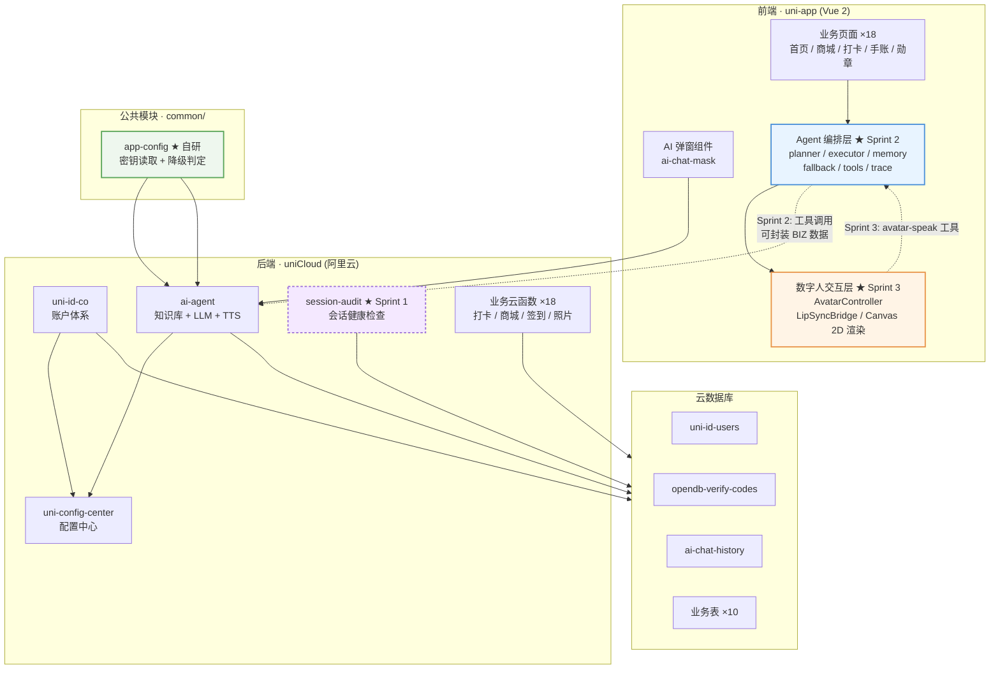

# 跨境共生小程序 · Cross-Border Symbiosis

> **乡村美食打卡小程序 + 自研 Agent 编排层 + 自研数字人交互层**
> 基于 uni-app (Vue 2) + uniCloud (阿里云) 构建，零配置可运行，不依赖任何收费 API。

**Author: CharLene** · **License: MIT** · **当前版本: v0.1.0 (Sprint 0)**

---

## Overview

### 这个项目解决什么问题

「跨境共生」是一个面向乡村文旅的美食打卡小程序：用户浏览村庄美食、拍照打卡、赚取积分、兑换特产。

项目在既有业务之上，要解决三件工程上真正困难的事：

1. **登录态不可靠** —— 原始项目直接使用 uni-id 默认配置，验证码用 `Math.random()` 生成（可预测）、错误尝试无次数限制、发送无频率限制，且没有"token 是否即将过期"的感知机制。用户会在关键操作（打卡 / 下单）时遭遇静默失败。
2. **"AI 功能"名不副实** —— 原始实现的 `ai-agent` 云函数本质是「知识库检索 + 单轮 LLM 问答」：没有工具调用、没有规划、没有降级链、没有可观测性。它拿不到用户的打卡记录、订单、签到数据，也无法执行任何动作。
3. **数字人只是两张 GIF** —— 原始实现的"数字人"是 `isSpeaking` 布尔量驱动的整图切换，口型是开/关两态而非参数化开合，没有队列、没有打断语义。

### 为什么值得做

这三件事的共性是：**表面功能可用，底层机制缺失**。本项目的价值不在于堆功能，而在于把这三处"能跑但不对"的地方，换成**可解释、可测试、可在面试中讲清楚**的自研机制。

项目采用 **Sprint 0 → 4 的敏捷迭代**，每个 Sprint 都有可运行增量，git 历史完整呈现迭代过程。

---

## Tech Stack

| 层次 | 技术选型 | 说明 |
|---|---|---|
| 跨端框架 | uni-app (Vue 2) | HBuilderX 工程，一套代码编译到微信小程序 / H5 / App(Android) |
| 状态与视图 | Vue 2 Options API | 与既有 18 个业务页面保持一致，不做框架迁移 |
| 路由与守卫 | `pages.json` + `uniIdRouter` | `needLogin` 声明受保护页面，`resToLogin` 开启自动跳登录 |
| UI 组件 | DCloud 官方 uni_modules ×16 | `uni-id-pages` / `uni-forms` / `uni-easyinput` / `uni-list` / `uni-captcha` 等 |
| 后端 | uniCloud (阿里云空间) | 21 个自研云函数 + 1 个配置读取公共模块 |
| 账户体系 | uni-id-pages + uni-id-co | 手机号验证码 / 微信授权 / 一键登录 / 账密 |
| 数据库 | uniCloud 云数据库 (MongoDB 协议) | 13 张表，schema 与种子数据分离 |
| Agent 编排 | **自研**（Sprint 2） | planner / executor / memory / fallback / 工具注册表 / trace |
| 数字人渲染 | **自研 Canvas 2D**（Sprint 3） | 无 Live2D、无二进制模型，形象由代码绘制 |
| 配置管理 | uni-config-center + 自研 `app-config` | 密钥集中管理，源码零凭据 |
| 打包 | HBuilderX 云打包 + GitHub Actions | Sprint 4 |

---

## Architecture



**★ 标记为本次迭代新增的自研模块**，其余为既有资产。

---

## Getting Started

### 环境要求

- HBuilderX **3.8.5+**（本项目在 HBuilderX 中开发，非 CLI 工程）
- 一个 uniCloud 服务空间（阿里云，免费额度即可）

### 步骤

1. **导入项目**
   HBuilderX → 文件 → 导入 → 从本地目录导入 → 选择本仓库根目录（`源代码/`）。

2. **关联 uniCloud 空间**
   在 `uniCloud-aliyun/` 目录上右键 → 关联云服务空间 → 选择你的阿里云空间。
   关联后 HBuilderX 会写入 `manifest.json` 的 `_spaceID` 与 `.hbuilderx/launch.json`（后者已被 `.gitignore` 排除）。

3. **上传云函数与数据库**
   右键 `uniCloud-aliyun/cloudfunctions/` → 上传所有云函数、公共模块。
   右键 `uniCloud-aliyun/database/` → 上传所有 DB Schema。
   右键 `uniCloud-aliyun/database/` → 上传所有 DB 数据文件（可选，仅用于演示种子数据）。

4. **运行**
   菜单栏 运行 → 运行到浏览器 / 微信开发者工具 / 手机模拟器。

### 开发阶段如何获取验证码

本项目默认走**手机号验证码登录**。开发阶段的验证码获取方式取决于 `uni-id` 配置：

- **未配置短信模板时**（仓库默认状态）：`uni-id-co` 进入测试模式，验证码固定为 `123456`，
  云函数响应中会带明确提示。见 [Known Issues](#known-issues--limitations)。
- **配置了真实短信模板时**：验证码通过短信下发到手机。

> ⚠️ 固定验证码 `123456` 仅适用于本地开发。**生产环境必须配置 `service.sms.scene.*.templateId` 与 `smsKey`/`smsSecret`**，
> 配置方式见 [`config.example.json`](./config.example.json)。

### 演示账号说明

仓库内 `uniCloud-aliyun/database/uni-id-users.json` 只包含 **1 条脱敏演示种子数据**：

- `mobile` 为 `189****2619` —— **这是不可拨打的占位符**，不是真实号码
- `password` 为 `null` —— 该账号走手机号验证码登录，无需密码
- `nickname` 为 `CharLene`

**实际登录时，使用任意手机号走验证码流程即可自动创建用户**，不影响演示。

### 校验仓库完整性

```bash
npm test
# → 校验 91 个 JSON 文件的语法正确性（标准 JSON / JSONL / 含注释 schema 三种格式）
```

---

## Security

### 密钥治理

本项目所有第三方服务凭据**均已从源码移除**，源码只保留 `your-*-placeholder` 占位符。
统一由 [`common/app-config`](./uniCloud-aliyun/cloudfunctions/common/app-config/) 读取，优先级：

```
uni-config-center (app-config plugin, 生产)
  → config.local.json (本地私有，已被 .gitignore 排除)
  → config.json (仓库内占位符，零配置默认值)
```

`isServiceEnabled()` 会同时校验 `_enabled === true` **且** 必填字段已从占位符替换为真实值，
任一条件不满足即判定服务未启用，调用方走本地降级路径。

### 历史密钥轮换清单

以下凭据曾存在于历史版本中，**均已在生产环境完成轮换**，且已从本仓库移除：

| # | 服务 | 历史密钥位置 | 状态 |
|---|---|---|---|
| 1 | DeepSeek LLM | `ai-agent/index.js` `DEEPSEEK_API_KEY` | ✅ 已轮换并外移 |
| 2 | 讯飞 TTS | `ai-agent/index.js` `XFYUN_APPID` | ✅ 已轮换并外移 |
| 3 | 讯飞 TTS | `ai-agent/index.js` `XFYUN_API_SECRET` | ✅ 已轮换并外移 |
| 4 | 讯飞 TTS | `ai-agent/index.js` `XFYUN_API_KEY` | ✅ 已轮换并外移 |
| 5 | 百度智能云 | `analyzeFoodPhoto/index.js` `BAIDU_API_KEY` | ✅ 已轮换并外移 |
| 6 | 百度智能云 | `analyzeFoodPhoto/index.js` `BAIDU_SECRET_KEY` | ✅ 已轮换并外移 |
| 7 | 腾讯云 COS | `getCosAuth/index.js` `SecretId` | ✅ 已轮换并外移 |
| 8 | 腾讯云 COS | `getCosAuth/index.js` `SecretKey` | ✅ 已轮换并外移 |
| 9 | 腾讯云 TTS | `getTTSSignature/index.js` `SECRET_ID` / `SECRET_KEY` | ✅ 已随死代码删除 |
| 10 | 微信小程序 | `uni-id/config.json` `mp-weixin.oauth.weixin.appsecret` | ✅ 已轮换并外移 |
| 11 | 微信开放平台 | `uni-id/config.json` `app.oauth.weixin.appsecret` 等 5 处 | ✅ 已轮换并外移 |
| 12 | 阿里云短信 | `uni-id/config.json` `service.sms.smsKey` / `smsSecret` | ✅ 已轮换并外移 |
| 13 | uni-verify 一键登录 | `uni-id/config.json` `service.univerify.apiKey` / `apiSecret` | ✅ 已轮换并外移 |
| 14 | uni-id JWT | `uni-id/config.json` `tokenSecret`（原为示例值 `tokenSecret-demo`） | ✅ 已轮换并外移 |
| 15 | uni-id 请求签名 | `uni-id/config.json` `requestAuthSecret`（原为示例值） | ✅ 已轮换并外移 |

### 第三方用户数据清理

历史版本中的 `uniCloud-aliyun/database/` 曾包含**真实用户数据**，涉及 11 名真实用户的
openid、session_key、JWT token、真实 IP、昵称与头像 URL，以及真实的聊天记录、
照片 URL、订单与打卡记录。

**这些数据已全部移除**，替换为脱敏种子数据：

| 文件 | 清理前 | 清理后 |
|---|---|---|
| `uni-id-users.json` | 11 条真实用户记录 | 1 条脱敏演示账号（CharLene） |
| `ai-chat-history.json` | 3 条真实对话 | 2 条标注 `demo:true` 的演示种子 |
| `user_photos.json` | 8 条真实照片记录 | 空数组 |
| `userCheckedPlaces.json` | 33 条真实打卡记录 | 空数组 |
| `user_orders.json` | 5 条真实订单 | 空数组 |

所有种子数据**不含真实手机号、IP、openid、token、图片 URL**。

### 云端同步删除说明（重要）

Sprint 0 在**本地**删除了 6 个云函数：

```
getTTSSignature
check_feature_status
checkinHandler
getMapJson
getUserOrders
uni-id-pages（官方模块副本，与 uni_modules/ 下版本重复）
```

> ⚠️ **仅删除本地文件是不够的。** HBuilderX 的「上传所有云函数」会先从云端拉取，
> 因此这 6 个云函数**必须手动到 uniCloud 控制台删除**，否则下次上传会被拉回本地：
>
> uniCloud 控制台 → 云函数空间 → 找到对应云函数 → 删除。
>
> `uni-id-pages` 是官方模块的重复副本，删除本地副本后，
> `uni_modules/uni-id-pages/` 下的官方版本仍会由 HBuilderX 正常同步部署。

---

## Configuration

### 零配置可跑

仓库 clone 后**不做任何额外配置**，默认路径即可完整跑通，且**不产生任何外部 API 费用**。

所有收费服务均为**可选适配器，默认关闭**。

### 能力开关表

| 能力 | 当前实现 | 默认策略 | 免费替代路径 | 启用方式 |
|---|---|---|---|---|
| LLM 问答 | DeepSeek API（收费） | 🔴 **默认关闭** | 本地 `knowledge.json` 检索 + 规则回答（零依赖） | `app-config.deepseek._enabled = true` + 填 `apiKey` |
| TTS 语音 | 讯飞 WebSocket（收费） | 🔴 **默认关闭** | 纯口型动画 + 打字机（无音频也能演示） | `app-config.xfyun._enabled = true` + 填 3 项凭据 |
| 图片识图 | 百度智能云（收费） | 🔴 **默认关闭** | 手动输入食材名，走本地规则 | `app-config.baidu._enabled = true` + 填 2 项凭据 |
| 对象存储 | 腾讯云 COS（收费） | 🔴 **默认关闭** | 改用 uniCloud 云存储（免费额度内） | `app-config.cos._enabled = true` + 填 3 项凭据 |
| 微信登录 | 微信 appsecret | 🟡 **可选** | 手机号验证码为主路径 | `uni-id/config.json` 填 `mp-weixin.oauth.weixin.*` |
| 一键登录 | uni-verify | 🟡 **可选** | 同上 | `uni-id/config.json` 填 `service.univerify.*` |
| 短信验证码 | 阿里云短信 | 🟡 **可选** | 开发期固定 `123456` | `uni-id/config.json` 填 `service.sms.*` |
| Agent 编排 | 规则适配器（自研） | 🟢 **默认可用** | — | 无需配置 |
| 数字人渲染 | Canvas 2D（自研） | 🟢 **默认可用** | — | 无需配置 |

> 详细的获取方式、配置位置与逐项说明，见 [`config.example.json`](./config.example.json)。

### 必须手动配置的两项（非外部收费服务，但生产必需）

```jsonc
// uni_modules/uni-config-center/uniCloud/cloudfunctions/common/uni-config-center/uni-id/config.json
{
  "tokenSecret": "your-token-secret-placeholder",        // ← 必须替换，JWT 签名密钥
  "requestAuthSecret": "your-request-auth-secret-placeholder" // ← 必须替换，请求签名密钥
}
```

这两项若不替换，示例值 `tokenSecret-demo` 会被沿用，**任何人都能伪造登录 token**。

---

## Known Issues & Limitations

当前阶段（Sprint 0）已知的问题：

| # | 问题 | 影响 | 计划 |
|---|---|---|---|
| 1 | 短信验证码开发期固定为 `123456` | 仅影响开发体验；生产需配置真实短信模板 | Sprint 1 / Sprint 4 文档化 |
| 2 | 验证码使用 `Math.random()` 生成（非密码学安全） | 理论上可预测 | Sprint 1 修复 |
| 3 | 验证码错误尝试次数无限制 | 可暴力猜码 | Sprint 1 修复 |
| 4 | 验证码发送无频率限制 | 可被刷短信 | Sprint 1 修复 |
| 5 | 手机号类型校验宽松 | 异常输入（数组/数字）未优雅拒绝 | Sprint 1 修复 |
| 6 | 无会话健康检查 | token 过期时用户无感知，关键操作静默失败 | Sprint 1 修复 |
| 7 | AI 问答无多轮记忆 | 每轮独立，不记得上文 | Sprint 2 修复 |
| 8 | AI 问答无工具调用 | 拿不到用户的打卡/订单数据 | Sprint 2 修复 |
| 9 | AI 知识库关键词加权逻辑失效 | 命中精度低于预期 | Sprint 2 修复 |
| 10 | `ai-chat-history` 每用户仅存最后一条 | 覆盖写，非历史记录 | Sprint 2 修复 |
| 11 | 数字人仅 GIF 整图切换 | 口型为开/关两态，非参数化 | Sprint 3 修复 |
| 12 | Android 权限申请过宽 | 含 `READ_LOGS`/`WRITE_SETTINGS` 等，上架会被驳回 | Sprint 4 收敛 |
| 13 | 硬编码 COS 域名遍布组件 | 多环境切换需改多处 | Sprint 4 收敛 |

---

## Features

> **TODO: 见 Sprint 1–3。** 本节将在登录增强（Sprint 1）、Agent 编排层（Sprint 2）、
> 数字人交互层（Sprint 3）完成后，按模块补齐并标注完成状态。

---

## Technical Highlights

> **TODO: 见 Sprint 3。** 本节将用「问题 — 机制 — 结果」三段式描述三个核心亮点：
> Agent 两阶段规划与降级链、会话健康检查层、数字人音频—口型桥接。

---

## Database Schema

> **TODO: 见 Sprint 1。** 本节将列出 `uni-id-users` 的扩展字段
> （`login_count` / `last_login_at` / `source`）、`opendb-verify-codes` 的关键字段，
> 以及 Agent trace 的持久化结构（若有）。

---

## Development Process

> **TODO: 见 Sprint 2。** 本节将包含 Product Backlog 表格、Sprint 划分，
> 以及每个 Sprint 的增量说明。当前迭代进度见 [`docs/敏捷开发过程.md`](./docs/敏捷开发过程.md)。

---

## API Documentation

> **TODO: 见 Sprint 2。** 本节将记录登录、`session-audit`、Agent 调用的接口示例。

---

## Build APK

> **TODO: 见 Sprint 4。** 本节将包含 HBuilderX 云打包完整步骤
> （发行 → 原生 App-云打包 → Android → 包名 → 证书选择）
> 与 GitHub Actions 自动打包（push tag 自动产出 APK artifact）。

---

## Production Deployment

> **TODO: 见 Sprint 4。** 本节将覆盖代码冻结与版本标记、生产云空间部署、
> 短信服务切换、APK 打包与签名、上线前检查清单、分发与反馈五个阶段。

---

## Future Work

> **TODO: 见 Sprint 4。** 计划包括 LLM 适配器落地、数字人 TTS 本地化、
> 应用商店上架材料（企业账号、隐私政策、软著）等。

---

## License

[MIT](./LICENSE) — Copyright (c) 2026 CharLene
